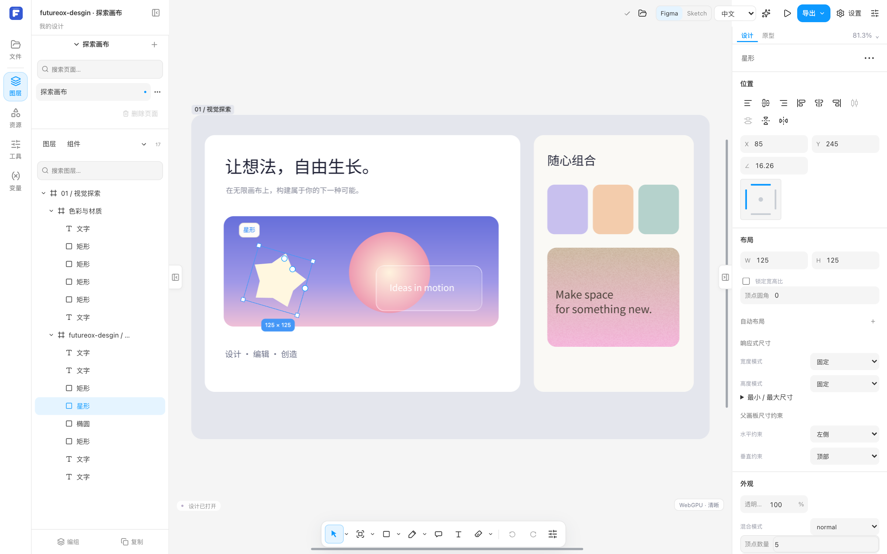

<p align="center">
  
</p>

# Futureox Design — Rust Vector & UI Design Editor

<p align="center">
  <strong>Open tools. Local files. Room to create.</strong><br />
  An open-source Rust vector editor and UI design tool for local-first web and Electron desktop workflows.
</p>

<p align="center">
  <a href="LICENSE"></a>
  <a href="docs/ROADMAP.md"></a>
  <a href="rust-toolchain.toml"></a>
  <a href="https://github.com/luckyzifan/futureox-design-editor/graphs/contributors"></a>
</p>

<p align="center">
  <a href="README.md">简体中文</a> · <strong>English</strong><br />
  <a href="#quick-start">Quick start</a> · <a href="docs/README.md">Documentation</a> · <a href="docs/ROADMAP.md">Roadmap</a> · <a href="CONTRIBUTING.md#english">Contribute</a> · <a href="https://github.com/luckyzifan/futureox-design-editor/issues/new/choose">Report an issue</a>
</p>

---

## A design workspace we can build together

Futureox Design is an **open-source Rust vector editor** and **UI design tool** for interface design, vector graphics, and local design files. It is a developer-alpha **Figma alternative** and **Sketch alternative**, with a local-first workspace on the web and Electron desktop. We want designers to shape the workflows and developers to understand, adapt, and extend the tools they use.

A **Rust kernel** handles document and editing semantics, with **WebAssembly (WASM)** bindings for the web. A **shared React client** connects the web and Electron desktop, with **WebGPU/CPU rendering** and local **Model Context Protocol (MCP)** automation. Core editing and storage are built around working locally.

<p align="center">
  
</p>

<p align="center"><sub>The built-in exploration document in the shared client. <a href="docs/assets/README.md">Screenshot provenance and reproduction</a>.</sub></p>

## What you can explore

| Area | Existing foundations | Details |
| --- | --- | --- |
| **Vector and interface design** | Shapes, pen and path editing, layers, text, fills, strokes, and masks | [Capability review (Chinese)](docs/LOCAL_DESIGN_FEATURE_MATRIX.zh-CN.md) |
| **Layout and reuse** | Auto layout, components and instances, variants, local variables, and styles | [Feature documentation (Chinese)](docs/README.md#5-编辑功能) |
| **Local workspaces** | IndexedDB on the web; a Rust/SQLite workspace, file saving, and recovery on desktop | [Desktop development](frontend/design-desktop/README.md) |
| **Design files** | Native `.fd` documents; FIG/Sketch/SVG/PDF import entry points and supported export paths | [File operation contract (Chinese)](docs/IMPORT_AND_LOCAL_OPERATION_CONTRACT_V1.md) |
| **Automation and extensions** | A local MCP adapter for querying, editing, and exporting through shared transactions | [MCP guide](frontend/design-mcp/README.md) |

**Current stage: Developer Alpha.** Build it, try it, and help improve it. Continuous zoom, large documents, heavy effects, format fidelity, and cross-platform desktop behavior remain active work. Feature documentation and verification records describe the scope actually supported and tested. See the [roadmap](docs/ROADMAP.md#english) and [current issue index #91](https://github.com/luckyzifan/futureox-design-editor/issues/91).

## Quick start

Install Git, the [pinned Rust toolchain](rust-toolchain.toml), Bun 1.4+, Node.js 24+, and Python 3. To start the web client from source:

```bash
git clone https://github.com/luckyzifan/futureox-design-editor.git
cd futureox-design-editor

rustup target add wasm32-unknown-unknown
cargo install wasm-bindgen-cli --version 0.2.130 --locked

cd frontend/design-client
bun install --frozen-lockfile
bun run dev
```

Open the local address printed by Vite, normally `http://127.0.0.1:1430`. `bun run dev` builds the Rust/WASM kernel first; the initial compilation takes time.

### Connect the web app to its backend

Create a PostgreSQL database, then build and start the same-origin web service from the repository root. The server runs migrations at startup and listens on `127.0.0.1:9430` by default.

```bash
(cd frontend/design-client && bun install --frozen-lockfile && bun run build)
export DESIGN_DATABASE_URL='postgresql://USER@127.0.0.1/DATABASE'
export DESIGN_API_TOKEN="$(openssl rand -hex 32)"
DESIGN_WEB_ROOT="$PWD/frontend/design-client/dist" \
  cargo run --locked --manifest-path design-studio/Cargo.toml -p futureox-design-server
```

Open **Server workspace** on the web home screen and enter the access token. Open a server design or link the current design from the editor. Subsequent edits are batched locally and sent to the server after local storage commits them. Vite proxies to the default backend in development and accepts `DESIGN_BACKEND_URL` as a proxy target.

| Goal | Start here |
| --- | --- |
| Run the Electron desktop app | [Desktop development and builds](frontend/design-desktop/README.md#develop-and-test) |
| Connect a local MCP client | [MCP adapter](frontend/design-mcp/README.md) |
| Select and run relevant checks | [Contributing](CONTRIBUTING.md#english) and the [testing requirements (Chinese)](docs/TESTING_CONTRIBUTIONS.zh-CN.md) |
| Understand web and desktop differences | [Web support boundaries](docs/WEB_SUPPORT_BOUNDARIES_2026-10-24.md) |

## Project structure

```text
frontend/
├── design-client/             React editor, WASM, browser rendering adapters
├── design-desktop/            Electron host, native bridges, packaging
└── design-mcp/                Local MCP protocol adapter
design-studio/
├── crates/design-kernel/      Documents, geometry, layout, history, formats, CPU rendering
├── crates/design-gpu/         Native GPU devices, resources, rendering
├── crates/design-desktop-backend/  Local files, SQLite, recovery
└── scripts/                  Kernel builds and verification tools
docs/                         Architecture, feature contracts, development records
testing/                      Format fixtures and compatibility scans
```

UI actions and automation use the same editing transactions; desktop capabilities connect through host adapters. Read the [architecture guide (Chinese)](docs/architecture/README.zh-CN.md) for responsibilities, or browse the [documentation index](docs/README.md).

## Help shape the project

Start small: reproduce a bug, improve an interaction, clarify a document, add a translation, or contribute an original test fixture for a tricky case.

- **Found a bug?** Use the [bug report form](https://github.com/luckyzifan/futureox-design-editor/issues/new?template=bug_report.yml) with your version, reproduction steps, and expected result.
- **Have an idea?** Describe the design workflow in a [feature request](https://github.com/luckyzifan/futureox-design-editor/issues/new?template=feature_request.yml).
- **Ready to make a change?** Read [CONTRIBUTING.md](CONTRIBUTING.md#english), keep the scope focused, and open a [Pull Request](https://github.com/luckyzifan/futureox-design-editor/pulls).

For larger features or architecture changes, discuss the direction in an Issue first. Rendering work follows the [rendering-first engineering contract (Chinese)](docs/RENDERING_FIRST_ENGINEERING_CONTRACT.zh-CN.md), with real interaction problems taking priority.

## Contributors

Thank you to the people building Futureox Design. There is room for you here, too.

<p>
  <a href="https://github.com/luckyzifan"></a>
  <a href="https://github.com/wangly19"></a>
  <a href="https://github.com/cursoragent"></a>
</p>

[View the full contribution history →](https://github.com/luckyzifan/futureox-design-editor/graphs/contributors)

[@luckyzifan](https://github.com/luckyzifan) · [@wangly19](https://github.com/wangly19) · [@cursoragent](https://github.com/cursoragent)

We also appreciate everyone reporting issues, joining discussions, and testing, along with the open-source communities the project depends on.

## License

The project's original code is licensed under the [MIT License](LICENSE). Third-party dependencies, fonts, assets, and tools retain their respective licenses; see [third-party notices](THIRD_PARTY_NOTICES.md).

Copyright (c) 2026 Cookieboty and contributors
