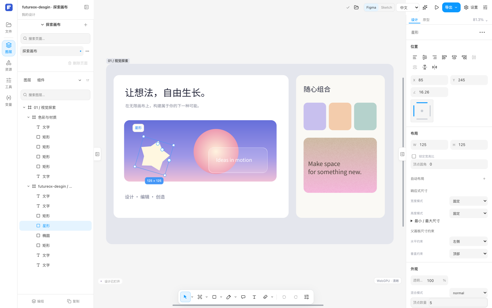

<p align="center">
  
</p>

<p align="center">
  <strong>让设计工具更开放，让创作留在你手中。</strong><br />
  开源、本地优先的 2D 设计编辑器，受 Figma 和 Sketch 启发。
</p>

<p align="center">
  <a href="LICENSE"></a>
  <a href="docs/ROADMAP.md"></a>
  <a href="rust-toolchain.toml"></a>
  <a href="https://github.com/luckyzifan/futureoxDesgin/graphs/contributors"></a>
</p>

<p align="center">
  <strong>简体中文</strong> · <a href="README.en.md">English</a><br />
  <a href="#快速开始">快速开始</a> · <a href="docs/README.md">文档</a> · <a href="docs/ROADMAP.md">路线图</a> · <a href="CONTRIBUTING.md">参与贡献</a> · <a href="https://github.com/luckyzifan/futureoxDesgin/issues/new/choose">反馈问题</a>
</p>

---

## 一个可以一起改进的设计工作空间

Futureox Design 面向界面设计、矢量绘制与本地设计文件处理。我们希望把画布、文档格式与自动化能力放在一个开放的代码库里，让设计师能够反馈真实工作流，让开发者能够理解、修改和扩展自己的工具。

项目以 **Rust 内核**承载文档与编辑语义，**React 共享客户端**连接网页和 Electron 桌面，配合 WebGPU／CPU 渲染与本地 MCP 接口。基础编辑围绕本地运行与本地存储展开。

<p align="center">
  
</p>

<p align="center"><sub>共享客户端中的内置「探索画布」示例。<a href="docs/assets/README.md">截图来源与复现方式</a></sub></p>

## 可以从这里开始探索

| 方向 | 当前已有基础 | 了解更多 |
| --- | --- | --- |
| **矢量与界面设计** | 形状、钢笔与路径编辑、图层、文字、填充、描边和蒙版 | [能力核对表](docs/LOCAL_DESIGN_FEATURE_MATRIX.zh-CN.md) |
| **布局与复用** | 自动布局、组件与实例、变体、本地变量和样式 | [功能文档](docs/README.md#5-编辑功能) |
| **本地工作区** | 网页 IndexedDB；桌面 Rust／SQLite 工作区、文件保存与恢复 | [桌面开发](frontend/design-desktop/README.md) |
| **设计文件互通** | `.fd` 原生文档；FIG／Sketch／SVG／PDF 等导入入口及受支持的导出路径 | [导入与本地操作契约](docs/IMPORT_AND_LOCAL_OPERATION_CONTRACT_V1.md) |
| **自动化与扩展** | 本地 MCP 适配器，通过共享编辑事务查询、修改和导出文档 | [MCP 入门](frontend/design-mcp/README.md) |

**当前阶段：开发者 Alpha。** 欢迎构建、试用和参与开发。连续缩放、大文件与重效果渲染、格式保真和跨平台桌面体验仍在完善中；已有实现的覆盖范围以具体功能文档和验证记录为准。当前优先事项见[路线图](docs/ROADMAP.md)，近期问题见[跟踪索引 #91](https://github.com/luckyzifan/futureoxDesgin/issues/91)。

## 快速开始

准备 Git、[Rust 工具链](rust-toolchain.toml)、Bun 1.4+、Node.js 24+ 和 Python 3。以下命令从源码启动网页客户端：

```bash
git clone https://github.com/luckyzifan/futureoxDesgin.git
cd futureoxDesgin

rustup target add wasm32-unknown-unknown
cargo install wasm-bindgen-cli --version 0.2.128 --locked

cd frontend/design-client
bun install --frozen-lockfile
bun run dev
```

打开终端中 Vite 输出的本地地址，默认是 `http://127.0.0.1:1430`。`bun run dev` 会先构建 Rust／WASM 内核；首次编译需要等待。

| 想做什么 | 从哪里进入 |
| --- | --- |
| 启动 Electron 桌面应用 | [桌面开发与构建](frontend/design-desktop/README.md#develop-and-test) |
| 配置本地 MCP 客户端 | [MCP 适配器](frontend/design-mcp/README.md) |
| 选择并运行相关检查 | [贡献指南](CONTRIBUTING.md#验证你的修改)与[统一测试入口](testing/README.md) |
| 理解网页与桌面的差异 | [Web 支持边界](docs/WEB_SUPPORT_BOUNDARIES_2026-10-24.md) |

## 项目结构

```text
frontend/
├── design-client/             React 编辑器、WASM 与浏览器渲染适配
├── design-desktop/            Electron 宿主、原生桥接与打包
└── design-mcp/                本地 MCP 协议适配
design-studio/
├── crates/design-kernel/      文档、几何、布局、历史、格式与 CPU 渲染
├── crates/design-gpu/         原生 GPU 设备、资源与渲染执行
├── crates/design-desktop-backend/  本地文件、SQLite 与恢复
└── scripts/                  内核构建与验证工具
docs/                         架构、功能契约与开发记录
testing/                      回归测试、夹具与统一运行器
```

界面与自动化使用同一套编辑事务，桌面能力通过宿主适配接入。详细职责见[架构分层](docs/architecture/README.zh-CN.md)；按主题查找资料，请从[文档索引](docs/README.md)开始。

## 一起把它做得更好

不必从一个大功能开始。复现一个问题、改进一处界面、修正文档、补充翻译，或为一个边界情况提供原创测试样本，都是很好的贡献。

- **遇到问题**：通过 [Bug 表单](https://github.com/luckyzifan/futureoxDesgin/issues/new?template=bug_report.yml)提供版本、复现步骤和预期结果。
- **有新想法**：通过[功能建议](https://github.com/luckyzifan/futureoxDesgin/issues/new?template=feature_request.yml)描述你希望完成的设计工作流。
- **准备提交代码**：阅读[贡献指南](CONTRIBUTING.md)，选择一个范围清晰的改动，提交 [Pull Request](https://github.com/luckyzifan/futureoxDesgin/pulls)。

较大的功能和架构调整，欢迎先在 Issue 中交流方向。渲染相关贡献优先解决真实体验问题，沿用[渲染优先工程规范](docs/RENDERING_FIRST_ENGINEERING_CONTRACT.zh-CN.md)。

## 贡献者

感谢一起打磨 Futureox Design 的朋友，也欢迎你的加入。

<p>
  <a href="https://github.com/luckyzifan"></a>
  <a href="https://github.com/wangly19"></a>
  <a href="https://github.com/cursoragent"></a>
</p>

[查看完整贡献记录 →](https://github.com/luckyzifan/futureoxDesgin/graphs/contributors)

[@luckyzifan](https://github.com/luckyzifan) · [@wangly19](https://github.com/wangly19) · [@cursoragent](https://github.com/cursoragent)

也感谢所有报告问题、参与讨论和测试的朋友，以及项目所依赖的开源社区。

## 许可证

项目自有代码采用 [MIT License](LICENSE)。第三方依赖、字体、素材和工具保留各自的许可证，详见[第三方声明](THIRD_PARTY_NOTICES.md)。

Copyright (c) 2026 Cookieboty and contributors
