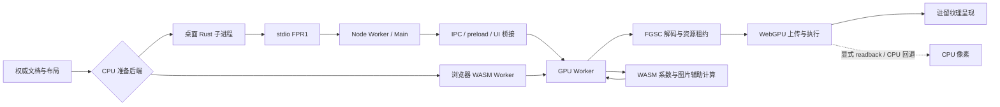

# Rust 数据结构、加载、布局、传输、颜色与模糊深度分析

日期：2026-10-31。范围：当前 design-kernel 工作区，以及父目录 core 的 Figma/Sketch 逆向资料。此轮是分析和独立探针，没有修改生产运行路径。此前已完成的预览/RootFacts/存储改动作为现状，未重复计为新成果。

证据目录：[analysis-render-dataflow-20261031](../testing/analysis-render-dataflow-20261031/)。源码基线、工具链、结构尺寸、实际文件清点、克隆探针和逆向复算均单独保存。本文区分：**实测**、**源码确认**、**优化建议**；建议不等于已获得整帧收益。

## 1. 主要结论

存在较大的结构优化空间。最值得先处理的是：

1. **无变化的 resize 仍遍历几何，并可能打断 Arc 共享。**
2. **渲染 Engine 的共享粒度是整个 Document，局部派生可能触发完整克隆。**
3. **Node 很宽，且绝大多数路径仍用编辑网络作为常驻表示。**
4. **布局固定点求解和 Grid 只读查询仍有整文档工作。**
5. **大 PNG 行解码存在重复初始化；ICC 变换在分条间未复用。**
6. **CPU→GPU 的包已经二进制化，但传输、解码和缓存仍有多份物化。**
7. **模糊有优化余地，但 CPU 滑窗、SDR RGBA 合并和部分缓存已经存在；不能把它们再列为缺失。**

大小端总体处理合理。当前更大的问题是对象宽度、复制粒度、工作面积、派生和请求所有权；不是把所有数据改为 f32、packed 或增加 GPU 提交队列。

## 2. 实测内存结构

### 2.1 当前编译器的尺寸

通过 Rust 1.96.1 对已有 native 库运行 `size_of/align_of/offset_of`；WASM32 对当前 release 库编译常量并读取 LLVM 数据布局，未将宿主尺寸冒充 WASM 尺寸。

| 类型 | ARM64 native 本体 | WASM32 本体 |
| --- | ---: | ---: |
| Document | 480 B | 256 B |
| Node | **2,040 B** | **1,360 B** |
| Paint | 440 B | 328 B |
| Stroke | 608 B | 424 B |
| Effect | 368 B | 312 B |
| Network | 96 B | 48 B |
| TextStyle | 232 B | 136 B |
| GpuNode | 1,752 B | 1,512 B |
| Transform | 48 B | 48 B |
| Pixel（RGBA f32） | 16 B | 16 B |

这里是本体尺寸，不含 Vec/String 内容、BTreeMap 叶节点空槽、分配器和资源缓存。Rust 默认表示的字段顺序不属于稳定 ABI；当前 Node 的 id 在偏移 424，transform 在 1888，visible 在 2033。不能把这个内存块直接当作 GPU struct 或跨进程格式。[Rust 官方布局规则](https://doc.rust-lang.org/reference/type-layout.html#the-rust-representation)

native Node 的公共字段本体合计 2,007 B，两个私有字段类型合计 32 B，当前编译结果只剩 **1 B 字段间/尾部 padding**。因此，仅重排字段或使用 packed 几乎不能解决这个 Node 的体积；未对齐访问反而增加风险。

### 2.2 真实拓扑快照

复用此前经验证的 300,408,797 B 原生快照，124,447 个节点、306 个根。探针仅做统计，不输出私有文本或图片内容。

| 项目 | 数量/占用 |
| --- | ---: |
| Node 本体合计 | **242.11 MiB** |
| 使用 Network 的节点 | **97,800** |
| 顶点 / 边 | 651,887 / 648,524 |
| Network 顶点/边 Vec 容量 | **135.58 MiB** |
| 网络点/边 ID 字符串有效字节 | 5.62 MiB |
| 使用 vector_geometry 的节点 | 48 |
| 独立共享 VectorGeometry | 10 |
| 独立几何曲线 Vec 容量 | 15.14 MiB |
| 48 个引用全部独立时的曲线有效字节 | 72.64 MiB，潜在去共享规模，不是实测 RSS |
| 填充 / 描边 / 效果记录 | 108,904 / 23,557 / 8,509 |
| text_style 有值 | 3,035，约 **2.44%** |
| constraints 有值 | 60,048 |
| 独立图片字符串载荷 | 57 份，44.70 MiB |

已统计的本体、网络、几何、图像字符串及填充/描边/效果记录，合计下界约 **505.49 MiB**。这不是 RSS，也未覆盖所有字符串、字体、元数据和 map 开销。

进一步使用仅在诊断程序中启用的 System 分配器计数：读入后 Rust 存活请求量约 **915.1 MiB**；把同一份节点键值通过有序 collect 重建 BTreeMap 后约 **710.8 MiB**，差约 **204.3 MiB**。重写后完整文件字节数和 Descriptor/Merkle 认证回执完全一致。但重建期间的请求量峰值约 **1,160.1 MiB**，高于原状态。这不是进程 RSS，也不能把“加载后再重建一次”直接作为优化交付。应比较直接批量构建、紧凑 handle→共享 Node、以及持久化节点存储，同时保留有序序列化；不能仅换 HashMap 或隐藏中间峰值。

还有一层容量成本：仅 fills/strokes/effects 三类 Vec 的闲置 capacity 就占 **168.5 MiB**。诊断进程在上述重建后收紧这三类 Vec，存活请求量进一步降至 **542.3 MiB**，完整认证回执仍一致。这个实验没有进入生产：每次编辑都 shrink_to_fit 会引入重新分配，适合研究的是解码/冻结快照的存储策略与峰值预算。三个数应一起看：原 915.1、实验稳态 542.3、实验中间峰值 1,160.1 MiB；不能只公布最后一个低值。

建议：

- 先拆分少数常用字段与大型可选字段。仅以 `text_style` 为例，改为间接存储的粗略槽位/载荷差额约 25.9 MiB/份文档；尚未计分配器、指针访问和重新布局，不能当成实际节省。
- 对几何采用不可变共享。`vector_geometry` 已使用 Arc，但 97,800 个 Network 仍是拥有式 Vec/String。只优化那 48 个 vector_geometry 节点不能覆盖主体。
- 可以保留编辑网络的稳定 ID，同时给渲染建立紧凑、可丢弃的 f64 几何视图；先保证不复制网络，再评估 opcode+坐标数组或块存储。不要为省空间量化 authored 坐标。
- 内部派生索引可使用 generation/owner 绑定的 u32 handle，外部文档 ID、保存格式、撤销语义仍保持原值。现有 RenderIndex 已复用父关系，但仍是 String→String 表，并非紧凑节点表。

## 3. 最明确的新增计算问题

### 3.1 identity resize 打断共享

[layout.rs](../design-studio/crates/design-kernel/src/layout.rs) 的 `resolve_roots` 初始化遍历调用 `resize(n, n.width, n.height)`；随后进入 [mutation.rs](../design-studio/crates/design-kernel/src/mutation.rs) 的 `resize`：

- 对 vector_geometry 先 `Arc::make_mut` 再 scale。
- 对 Network 遍历全部顶点与控制点，乘以宽高比例。
- 没有尺寸确实不变的提前返回。

所以，比例为 1 仍有工作；存在强共享时，调用 scale 前就可能复制完整曲线。这会抵消前面建立的几何共享。样本中的共享几何规模见上表，不能直接把潜在 72.64 MiB 写成每次必然增加。

优先做法：在原 clamp 和文字锚点语义之后，识别**有限、正尺寸且位模式不变**的 no-op，避免进入几何写路径。必须覆盖零尺寸、负零、min/max clamp、Hug 文本锚点、反射/旋转及真实 resize；不能只用宽高 `==` 就跳过原有拒绝和校正。

### 3.2 Arc<Document> 不是逐节点 COW

[renderer.rs](../design-studio/crates/design-kernel/src/renderer.rs) 中，`SharedDocument(Arc<Document>)` 的 `DerefMut` 调用 `Arc::make_mut`；Document.nodes 是 `BTreeMap<String, Node>`。install 后 source_doc 与 doc 共享，resolve_layout 又保留 before；进入可变 resolver 时可触发整个 Document 的 clone。需要富文本扩展时还会保留 text_base。

编辑历史的 [snapshot.rs](../design-studio/crates/design-kernel/src/snapshot.rs) 已采用 `im::OrdMap<String, Arc<Node>>`，但渲染 Engine 没有直接使用同样的粒度。不能笼统说项目没有结构共享，也不能据此说渲染修改已是局部复制。

对真实文档的 **release Document.clone 独立探针**：首次约 581 ms，后两次约 169/172 ms；销毁约 201/80/63 ms。这不是一次拖动或整帧的实测延迟，也不表示每次输入都会克隆；它说明该操作一旦进入热路径就值得重视。`/usr/bin/time` 的 RSS 查询被系统权限拒绝，未报告峰值 RSS。

建议分步推进：共享 Network 等大载荷 → 减少可变借用导致的无效分离 → 让派生布局输出变化节点/字段或独立结果表 → 渲染读同一权威快照及派生视图。避免再造第二份可编辑文档真相。

### 3.3 布局固定点求解与只读查询

`layout::resolve_roots` 上限为 68 轮，每轮前后构造状态 Vec，再进行约束与布局扫描。实际会收敛提前返回，**不是每帧固定扫描 68 次**；layout_dirty 为 false 时 Engine 已跳过求解。

全量 state 每节点含 Transform+宽高，当前为 64 B；124,447 节点约 7.60 MiB，一轮 before/after 约 15.2 MiB 状态数据。scoped 求解已有，但前置特性检查、父表、依赖闭包和部分验证仍可能全表扫描。

更具体的 UI 入口：[Canvas.tsx](../frontend/design-client/src/Canvas.tsx) 选中 Grid frame 时在 render 中直接调用 `gridOverlayRectangles`；[grid-overlay.ts](../frontend/design-client/src/grid-overlay.ts) 序列化整份 doc；WASM `layout_grid_frame_json` 再解析，`grid_tracks` 校验并 clone 全文档，最终仅返回该 frame 的行列轨道。该路径没有在这个调用点按不可变文档/字体代次缓存。当前拓扑样本没有 auto-layout Grid，不能把它当成本样本的已测瓶颈。

建议先把只读轨道结果作为既有布局求解的产物复用；再用受影响根队列、组件反向依赖表和未变化子树证明减少 fixed-point 工作。保留收敛上限与失败，不把上限直接调小。

## 4. 大小端与 GPU 内存布局

当前已确认：

- FXSCENE、FGSC、FPR1 的长度和数值字段显式采用 LE；TS DataView 的对应读取使用 littleEndian=true。
- WGSL host-shared 数值和 WebAssembly 线性内存本身采用 little-endian。[WGSL](https://www.w3.org/TR/WGSL/#internal-layout-of-values)、[WebAssembly](https://webassembly.github.io/spec/core/exec/numerics.html#storage)
- PNG 16-bit 行样本是另一种文件格式，`image_rows.rs` 已用 `u16::from_be_bytes`，并非端序错误。
- Float32Array 的批量视图沿用了当前支持的 little-endian 主机条件；新大端目标须另有显式适配，不能把它当成现有性能瓶颈。

Rust Node 不是 GPU POD。WGSL `vec3<f32>` 对齐 16、大小 12，数组步长 16；与 Rust `[f32;3]` 的自然布局不同。应只给明确的传输/上传 struct 定义布局与偏移断言，不应给整个业务 Node 加 repr(C)/packed。[WGSL 布局](https://www.w3.org/TR/WGSL/#alignment-and-size)

现在多数 GPU 参数使用 64 个 vec4、每次 1,024 B；`parameters()` 分配 256 个 f32，`WebGpuDriver.uniform()` 再拷入 arena。这个布局一致、易验证，但简单 pass 也支付完整参数块。可研究按 pass 家族压缩字段/复用参数构造；必须同步 WGSL minBindingSize、动态偏移和 arena 生命周期，不能只缩小 JS 数组。

另一个低优先级契约点：frame_wire 泛型整数统一转 f64，超出 2^53 的整数无法精确保留。当前帧 ID/长度等主要受 u32/设备额度约束，未确认生产数据超界；未来扩展 u64 字段应增加明确标签或范围检查，而非假定该编码可无损承载所有 Rust 整数。

## 5. 传输与 CPU/WASM/GPU 路径

桌面 native 与浏览器 WASM 是准备后端的两条路线，不是每帧把完整场景依次重新算三遍。GPU Worker 仍使用 WASM 辅助计算；UI 的编辑/命中也有自己的 WASM 状态。应分别统计模块代码、线性内存、文档实例与缓存，不能直接相乘当作同一份物理内存。

### 5.1 已存在的复用

- 同一不可变 document 的纯相机变化，client 已不重复序列化整份文档。
- native source 走 opaque capability→磁盘描述符，不把 300 MB 快照重新传回 UI。
- FGSC 已有资源 ID、已知范围 ACK、同请求缓存和精确内容身份；GPU program arena/mirror 也会只上传差异。
- Node Worker→Main、UI→GPU Worker 的相应 ArrayBuffer 路径使用 transfer；不能把每个 postMessage 都算成深拷贝。

### 5.2 仍存在的物化与复制

| 位置 | 源码确认的工作 | 优化方向 |
| --- | --- | --- |
| Rust packet encode | Node canonical/source identity 与实际 NodeResource 分别编码；命中资源缓存前仍可能准备/编码内容 | 拆开世界几何、采样、材质和摆放身份；用可信派生 revision 复用，保留精确比较 |
| wasm-bindgen Vec 返回 | `compile_gpu_packet` 包装器 `.slice()` 后释放 Rust 返回区 | 若改为 lease/view，必须明确 memory.grow、释放和跨 Worker 所有权；不能直接返回裸指针就称零拷贝 |
| NativePreparationFrame | stdout 分块被复制到一份精确大小、可 transfer 的 Uint8Array | 此处已有避免 Buffer 池/反复 concat 的设计；再优化应改分段消息或共享载荷协议 |
| Electron invoke / contextBridge | 当前 route 是复制型 IPC/隔离上下文桥接，没有全链 transferList | 身份校验消息与大字节数据分开，减少经过 UI 的字节；先测真实边界耗时 |
| scene-packet 解码 | 新资源 `data.slice()`；几何区 `bytes.slice()`；coalesced copy 可能再复制整包及几何 | 分段拥有式 blob/只读租约，避免生命周期互相拖住 |
| GPU 上传 | 真正变化的 geometry/image 仍需 writeBuffer/writeTexture | 保持现有 residency 和增量上传，不增加多份 GPU owner |

几何 slice 当前有明确理由：防止长期 scene 引用把整包图片载荷一起留住。简单改成 subarray 可能省一次复制，却增加长期驻留。

Electron invoke 使用 Structured Clone，contextBridge 的参数/返回值也按复制语义传递；具体物理复制次数仍需实际版本测量。MessagePortMain 的 transfer 参数是端口列表，**换 MessagePort 不自动意味着跨进程 ArrayBuffer 零拷贝**。[IPC](https://www.electronjs.org/docs/latest/api/ipc-renderer#ipcrendererinvokechannel-args)、[contextBridge](https://www.electronjs.org/docs/latest/api/context-bridge#parameter--error--return-type-support)、[MessagePortMain](https://www.electronjs.org/docs/latest/api/message-port-main#portpostmessagemessage-transfer)

大普通 JSON 请求超过分帧阈值时，`documentFrames` 仍按 1 MiB 做 base64 信封，接收方重组完整请求；普通小包已避免额外换行 concat。这不影响小描述符的 native-source 路径，不能把两者混为同一启动成本。

## 6. 调度与加载方式

已有单个 speculative PrepareAhead、单 GPU raster owner、有界源转换和晚回/取消保护。现在更值得解决的是长 CPU 作业、GPU Worker 内同步辅助计算，以及等待 GPU 回收资源导致的队头阻塞。

- 浏览器无 SharedArrayBuffer 时，活动 WASM 编译不能靠普通消息立即中断；代码保留物理完成栅栏是必要行为。可缩小可取消工作单元，不能假装取消已回滚。
- WebGPU finish 的等待有 readback、timing、presentation transfer、prefix scratch、image-table scratch、interaction 和周期背压等原因。提交 ACK 不能授权销毁在途资源。[WebGPU promise/completion 规则](https://www.w3.org/TR/webgpu/#dom-gpuqueue-onsubmittedworkdone)
- 可以继续按完成批次退休 scratch，避免只为释放临时表而等待；已有相关优化和失败实验，不应把所有 wait 删除或盲目增加提交队列。
- `prepareFilters` 在常见 managed 路径会准备 4 个 exact channel 加 scalar；SDR canvas 又准备 4 个 channel、scalar、RGBA。代码显示最多 11 个相关 pipeline 的冷准备，即使某帧主要使用 RGBA 路径。可按实际 pass 需求先准备首选，回退按需建立；还需测试创建失败、device loss 和回退首帧。

完整源加载的下一步应是既有权威模型的 **Loaded / Cold / Missing 明确区分**、可随机读取的认证记录、稳定的派生 ID、已知依赖闭包及完整消费者回退。Figma 的 encoded-offset 索引、派生依赖事件和 Sketch 的 required-page/symbol 部分加载提供方向，但它们不证明任意文件打开可以做到 O(视口)。全文件索引、归档 CRC、全局布局与背景依赖仍可能要求读全源。

## 7. PNG 加载与色彩：两个可局部推进的重复点

### 7.1 大 PNG 初始化两次

[image-row-source.ts](../frontend/design-client/src/kernel/image-row-source.ts) 的 `nativeImageRows` 先建 ImageRowDecoder 取宽高并 free，真正遍历时再建一个。Rust `Decoder::new` 两次都进行完整 base64 解码和 PNG 元数据初始化。它避免了完整像素物化，但不等于没有重复编码数据读取。

建议用明确生命周期的单 decoder 入口，或把有验证的轻量 metadata 检查与实际解码分开。不能只是把 decoder 留在闭包里而忽略“迭代器从未消费”、取消和释放。

### 7.2 ICC 变换在每个 strip 重建

[image_rows.rs](../design-studio/crates/design-kernel/src/image_rows.rs) 每次 read_rows 调 [image_color.rs](../design-studio/crates/design-kernel/src/image_color.rs) 的 to_working；ICC 分支会重新解析 ColorProfile 并 create_transform_f32。每个 strip 最多 262,144 像素，大图可有数十条 strip。

建议把 `PreparedImageColorTransform` 保存在同一 Decoder 生命周期内，按原颜色政策准备一次，逐行复用。原有 profile/TRC/CLUT 限额、错误、alpha 和舍入顺序要保留。这是条件命中：有明确色彩标记而绕过 ICC 的图片不支付该构建；本轮没有测拓扑文件的 ICC 命中率或端到端收益。

CPU 完整图片的 Images.image_at 仍先建立原生 base 再产生 mip；大 PNG 的 GPU 路由已有单独行解码，不能据 CPU 解码预算失败断言 GPU 行加载也必然失败。JPEG/WebP、旋转/交错 PNG 的加载策略和 CPU/GPU 图像工作集仍应分别盘点。

### 7.3 共享像素不等于共享所有图片数据

`paint::Images` 的 cache 是 `HashMap<String, CachedImage>`，键来自 `data.to_owned()`；Images 的 Clone 会复制这些 URI 字符串，而 CachedImage 的像素通过 Arc 共享。`snapshot_worker`、resolved source compiler 都有 images.clone 路径。按字符串查缓存还会散列其内容，不能把已存在的像素共享说成所有图片开销均消失。

可复用已经存在于 frame_scene 的“强 Arc 所有权 + 私有分配身份 + 精确内容校验”思路，给 decoder 传稳定资源句柄，避免缓存键再次拥有整段 data URI。仅改成 HashMap<Arc<str>,…> 仍可能反复按内容哈希，不能自动解决这一点。实际成本取决于当时缓存中有哪些图片，本轮没有把 57 份全部当成 decoded cache 同时驻留。

## 8. 模糊算法的实际状况

样本可见效果计数：Gaussian 2,515、shadow 3,245、inner-shadow 1,087、background-blur 301、color-controls 176、motion-blur 12。计数不等于 GPU 时间，但说明应区分不同滤镜而非优化一个泛称 blur。

| 路径 | 当前实现 | 还值得研究 |
| --- | --- | --- |
| CPU Gaussian | 三次 box、双轴、滑动和；每行缓存、误差区间与精确 tie fallback | 减少无用输入/输出面积与复制；不能再宣称缺少滑窗 |
| Integrated tent / exact filter | 有理系数与指定 RNE，整数累加；certified 快路与精确回退 | 保留原系数，按范围证明选择更便宜的执行方式 |
| SDR WebGPU blur | 补偿 f32、RGBA 合并、异常通道回精确；alpha 有 scalar 路径 | 首选 pipeline 按需准备、pass/面积/带宽调度 |
| Motion / Zoom | 原采样表、有限 support、多 tap；显示有单独浮点路径 | 缓存系数/坐标，减少 Worker 同步准备；注意方向与径向依赖 |
| Gaussian prefix / reduced surfaces / paired taps | 候选已经存在，分别受能力与策略门控 | 按半径、面积、冷/暖、scratch 和 fence 成本选择，不整体启用 |

这里“精确 Gaussian”通常是对**所选三盒模型、离散采样及舍入合同**的精确执行，不是连续高斯函数的解析解。普通 blur、Gaussian、tent、背景 blur 也不是可任意互换的算子。

在 GPU 上，收益可以来自少处理像素、少读写浮点面和少 pass。RGBA32F 每像素 16 B；512² 单面约 4 MiB，四份相关样本约 16 MiB，六遍最低一次读+一次写已是约 192 MiB 的名义数据流量，尚未计 halo、多 tap、cache 命中和其它层。这个量级说明为什么仅减少几条系数算术未必改善整帧。

前缀方法有额外 scratch、扫描、重建和回收等待，成对 bilinear 采样会改变浮点执行顺序。f16/低分辨率中间面也涉及误差合同。它们可以作为限定显示候选，不能无条件用于 HDR、精确输出或所有材质；不以放宽预算、降低最终分辨率获得“通过”。

## 9. 对父目录逆向资料的复核

已读 Figma 的 BIG-FILE-PIPELINE、SCENEGRAPH-INTERNALS、RENDER-DETAILS、SHADER-TRIGGERS 和原始 `shader_76.glsl`；Sketch 的部分加载、效果/颜色草稿，以及 `MSBitmapEffectsContext.txt` 原始反汇编。

可确认并借鉴的机制：

- Figma shader_76 有相邻 tap 的加权坐标合并、条件式成对 fetch、clamp 和有界循环；不是任意 kernel 都能减少一半 fetch。
- 该 shader 的边界权重/归一化与本项目透明域、完整分母及 edge-extend 策略不能直接等同。成对采样公式在实数上相似，也不证明硬件插值与当前逐 tap 舍入逐位相同。
- Figma 字段级派生依赖和事件合并值得参考；资料本身区分已验证/推断，并有旧函数号勘误。不能从描述符步长推导整个 Figma Node 的 sizeof，也不能把 facet 自动等同于 ECS/SoA。
- Sketch 保存的这条效果路径使用小位图、vImage box 卷积、context pool 与回贴；这只是该版本所追到的路径，不能推广为所有 Sketch 版本/后端均只用 CPU。
- Figma 某些 shader 存在但受 feature/platform gate 控制。归档源码存在不证明默认会话使用，更不证明与本项目逐位一致。

### 9.1 Sketch 降采样表发现勘误

`drafts-32/03-effects-mask-blend.md` 与 `32-rendering-mechanisms-atlas.md` 的表格漏掉 7 的分界，并将部分比例及 49 写错。对保存的 `imageScaleForBlurRadius:`（0x168024）指令做小范围解释执行，有限非负输入得到：

| effective blur r | scale |
| --- | ---: |
| 0 ≤ r ≤ 5 | 1.0 |
| 5 < r ≤ 7 | 0.9 |
| 7 < r ≤ 9 | 0.8 |
| 9 < r ≤ 10 | 0.7 |
| 10 < r ≤ 24 | 0.6 |
| 24 < r ≤ 49 | 0.5 |
| 49 < r ≤ 100 | 0.4 |
| r > 100 | 0.25 |

例如 r=100 返回 0.4，不是草稿例子中的 0.25。`reverse-blur-table.py/json` 保存了复算、边界输入及原始反汇编 hash。没有修改父目录资料，也没有把该表直接合入本项目；实际取样、背景质量位和颜色合同还要分别验证。

### 9.2 颜色路径不能照搬

逆向记录的 Sketch Quartz/Metal 路径使用目标空间的 8-bit 预乘瓦片，并由显示层声明色彩空间。这不能证明本项目的线性 HDR/RGBA32F 工作空间应该删除。应借鉴“明确每一层的颜色语义、避免重复转换”，而非把宽色域/HDR 当作无用计算。

## 10. 颜色计算的具体方向

现有实现已经有 Sampler 的颜色/渐变停止点准备、prepare_from_working/prepare_output、合并后的 ColorControls 矩阵、图片缓存和 managed/unmanaged 区分。这些不能再算作缺失。

优先建议：

1. 上述 ICC transform 按 decoder 生命周期复用。
2. 对固定输入空间准备 to_working 的策略和系数，减少逐像素 dispatch；保持原矩阵乘法顺序。源码中的常数 inverse 可能已被编译器折叠，不能未经汇编/profile 就算作每像素完整求逆。
3. 对明确 8-bit 输入评估精确 LUT。表值须复现当前 `f64::from(f32(n/255))` 等归一化顺序，而非随意改成 `f64(n)/255`。任意 authored float、HDR、ICC CLUT 不适用同一简化。
4. 以明确的 encoded/linear、色域、premultiplied/straight 表示约束 CPU/GPU 边界；减少 encode→decode 往返，但 Sketch encoded-space controls 的往返具有语义，不能直接删掉。
5. f16、近似 transfer function 和融合矩阵需要各自误差/导出门。alpha 是覆盖，不能套 gamma；低 alpha、负值、超参考白、透明边缘和 P3 需保留测试。

## 11. 建议推进顺序与验收

| 优先级 | 工作 | 主要收益/边界 | 必要验证 |
| --- | --- | --- | --- |
| P0 | no-op resize guard，保护共享几何 | 小范围修改，直接减少遍历和 Arc 分离 | 零/负零/clamp/真实 resize、共享指针、模型和像素不变 |
| P0 | PNG decoder 生命周期与 ICC transform 复用 | 源读取、色彩准备重复消减 | tagged/ICC/坏 profile、16-bit BE、取消、CRC、完整像素一致 |
| P1 | Grid 只读结果复用、布局状态 scratch/受影响根 | 避免 UI render 中全量 JSON 与 clone | 字体/文档/父变换失效、真实 Grid GUI 路径 |
| P1 | Network 不可变共享、Node 冷字段拆分 | 数百 MiB 级表示与复制成本的候选 | CPU/WASM 布局、历史/编辑隔离、内存峰值与真实操作 profile |
| P1 | 宽 Node 的 map 存储与批量构建 | 当前探针有约 204 MiB 稳态差额，但中间峰值更高 | 不只看最终占用；节点/顺序/回执一致及峰值预算 |
| P1 | 不可变快照的大元素 Vec 容量 | fills/strokes/effects 闲置容量约 168.5 MiB | 编码一致、冻结/编辑转换成本；避免热路径反复 shrink/grow |
| P1 | 派生布局表/逐节点 COW | 去除整 Document 分离 | 权威快照、事务回滚、完整 fallback、derived ID/字体语义 |
| P1 | 分段 packet 与大数据通道 | 少物化、少 UI 桥接字节 | 字节/复制归因、lease 释放、错误/取消/晚回 |
| P1 | 滤镜 pipeline 按需准备和区域成本模型 | 冷帧准备、像素面积/带宽 | 真实 GPU 冷暖、pass/像素数、精度、回收和 device loss |
| P2 | 共享编码数据上的惰性权威加载 | 最大结构收益，也最大范围 | Loaded/Cold/Missing、全局依赖、完整导出/保存/编辑 |
| P2 | f16、降采样、SIMD、成对 taps 等新配置 | 依赖场景和精度合同 | 同源 ABBA、误差门、warm 帧、资源压力；不能只用算子提速 |

先增加可归因的指标：整 Document clone 次数/字节、实际布局轮数与访问节点数、PNG 初始化/ICC 准备次数、每边界传输字节、FGSC 编解码字节、实际 GPU 上传量、滤镜像素×pass、按原因分类的 GPU 等待。已有 stage、queue、geometryUpload 和 fast-path 统计可复用，避免再造全套遥测。

本轮没有新增生产优化或性能开关，没有进行新的硬件 GPU/整编辑器验收，也没有把逆向资料当作当前软件的性能保证。上述结构测量、静态路径确认与孤立 clone 数据，足够确定下一轮优先级；整体加速仍须在真实文件的有效可见内容上证明。
