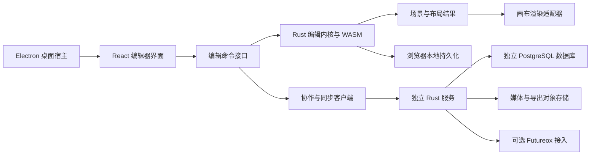

# Figma 替代产品架构与实施方案

## 2026-10-18 Electron 精确驻留与跨端验证

[源码] Electron SDR 默认允许同设备 WebGPU 驻留呈现与 CPU 准备线程，精确算术、采样密度及 HDR 开关仍分别控制。纹理工作池按实际表面需求采用已有动态策略，不以 `displayMath` 决定内存额度；512 MiB 起步、1 GiB 策略上限仅适用于非相关采样的驻留工作表面，并非设备剩余显存或整个进程总预算。相关采样及非驻留路径继续各自的预算。

[源码] 世界锚定捕获与精细瓦片共用计算相机，效果邻域相对实际输出矩形计算，避免重定位浮点运算造成微小像素差异。超出工作预算时保持密度，以带边距的分块整组替换旧完整姿态；取消或失败不能发布半组结果。HQ resolve 不使用尚未转换坐标域的交互裁剪。首屏、交互准备及松手完成仍分别计量。

[源码] 画板与 Section 标题接入现有选择/拖动入口，GPU 绘制标题时保留对应 SVG 命中区；页面归属、继承锁定和可见性仍参与判断。不能编辑的标题不会把拖动传给其后面的对象。Shift 选择与拖动阈值沿用普通画布规则。

[源码] 本地桌面构建默认 release，调试需显式 `--debug`；后端与原生 GPU 工具共用一次 Cargo 构建图。原生 sidecar 的回读探针仍是诊断入口，普通画布直接使用 Electron 中的本机 WebGPU 设备，不通过该探针传送帧像素。隔离验证模式可运行与 Web 相同的页面，关闭测试窗口遮挡节流只用于该模式，产品窗口策略不变。

[边界] HDR 没有扩展验收。SIMD/wasm-opt 仍可选；相关采样玻璃稀疏场的 `VITE_DESIGN_COHERENT_SPARSE_GLASS=1` 仅为实测对照开关。新的任务覆盖、逐次失败与成功记录、性能及外部 Figma 差异按[迭代计划](design-rendering-iteration-plan-2026-10-18.md)分项记录；下面各日期的小节保留历史范围，不能将“Electron 未验收”等旧结论直接用于当前批次，也不能把本次局部通过扩大为完整 Figma 一致。

[已验证] 同一 19,949 节点文档的五轮桌面对照，每轮 37 个固定玻璃/multiply/重叠画板姿态：合并更新中位数约 890→295 ms、p95 954→374 ms，松手提交中位数 1,922→225 ms。比较基线是先修复到可工作的精确分块版本，包含工作内存准入恢复的收益，不是等内存算法对照。四个中间位置及最终画面与独立精确重画零差。Web/Electron 的白缝、对齐、缩放覆盖和实际文件操作分别验证；冷缩放仍会暂用旧密度像素，外部 Figma 参考仍不相等。原始样本、失败和验证边界见[本轮记录](../../testing/review/design-rendering-runtime-2026-10-18.json)。

## 2026-10-17 编译复用、背景失效与完整密度交互

[源码] 相机准备结果的轮廓改为不可变共享数据；同一几何版本、页面、相机、动画时刻和准备范围内，按节点/笔画、精确裁剪、填充规则与采样合同复用区间程序，独立缓存上限 32 MiB。修改文档、字体或相机合同会失效；未用近似哈希替代像素证明，也没有省略必要的最终瓦片编译与序列化。真实文档的 18 份优化前后命令包 SHA-256 全部一致。

[源码] damage 保留旧/新位置及背景依赖输出的矩形集合，并在一次补丁内复用实际字体/曲线边界。背景读取按隔离容器分域；子节点变化不反向失效祖先在绘制子节点之前执行的背景模糊。前景效果、蒙版、组件、布局及无法证明的玻璃读取继续保守处理。Web 驻留瓦片、Worker 精确缓存和 CPU 瓦片装配共同消费矩形集合；旧单包围盒仍供兼容使用。

[源码] Web SDR 的交互源缓存上限提高到 256 MiB，并与工作表面分开记账：交互工作表面仍为 512 MiB，默认四采样精细工作表面仍为 256 MiB。因此交互源加工作表面最高可到 768 MiB，显示纹理和几何/驱动缓冲另有预算，不能把 512 MiB 宣称为整个设备总占用。连续覆盖掩码使用 R32F 保存原有 f32 数值，读取时展开；彩色表面保持原精度。节点读完后按所有权回收掩码，热缓存与可复用表面保留；只有确需新增空间时才等待 GPU 后销毁资源。独立大图层/前景效果缓存、普通叶节点直接绘制、背景模糊透明源的直接合成和有采样余量的局部混合减少中间工作。背景读取与混合顺序仍由内核合同约束。

[源码] 临时交互只保留一帧 GPU 在途工作，输入继续合并为最新位置。纯根节点位移松手时复用当前 Worker 位置会话，普通文档 lane 独立补精细画面；不兼容修改保留重编译回退。后端切换时，新 GPU 画布在保留画面下方先完成真实绘制和确认，再移除旧画面；不再因隐藏提交为空而相互等待。`VITE_DESIGN_SCALAR_COVERAGE=0`、`VITE_DESIGN_REGIONAL_BLEND=0`、`VITE_DESIGN_DIRECT_BACKDROP=0` 和 `VITE_DESIGN_RETIRE_NODE_MASKS=0` 仅用于独占诊断对照。

[验证与边界] 同一 2256 节点、三重叠画板、外部背景模糊/multiply 文档在 1000×640 CSS、DPR 2、60% 倍率下由 0.6 采样恢复到 1.2；整板及内部小文字修改的增量结果与新建渲染器完整重画逐像素一致，后者只补 2 块精细瓦片。完整密度的拖动耗时仍高于旧半密度路径，不代表稳定 60 FPS；更大的视口仍受 4M 交互像素上限约束，嵌套连续修改仍可能重编译。Figma `effectPassFusion` 与背景失效遥测提供分离缓存、工作表面及依赖传播的方向，以上预算和具体实现不是已恢复的 Figma 常量。每批计时、失败实验、像素结果及资源成本见[完整记录](../../testing/review/design-damage-and-compile-2026-10-17.json)。HDR 与 Electron 未扩展验收。

## 2026-10-17 瓦片批次与补画优先级增量

[源码] 屏内精细瓦片按最多 32 块合并协议请求。Worker 仍逐瓦片完成 GPU 工作，在帧边界让出给交互任务并恢复原文档 lane；新相机取消旧批次的剩余瓦片，已经完成的同文档瓦片继续可用。内容取消与相机取消分开，不能在一个 GPU 编码器中交错两个场景。`VITE_DESIGN_TILE_BATCH=1` 仅用于逐瓦片对照。默认 WebGPU 早已同设备显示，本增量没有把兼容 ImageBitmap 路径误作默认路径重新实现。

[源码] 拖动提交后，只有仍由交互控制器覆盖的预览与同会话完整底图才能免去前置概览/粗层；其它内容编辑沿用原来的覆盖准备。首次概览完成后重新判断覆盖，避免根据先前的空覆盖状态再排整组粗瓦片。这些判定只调整补画顺序，精细完成仍要求当前文档、相机和显示确认。开发模式保留最近 256 条瓦片 compile/graph/finish/checkpoint 记录；独占诊断配置 `VITE_DESIGN_TRACE_PASSES=tile` 可记录预算失败时的分配量和最大的 16 个存活表面。

[验证边界] 同一私有 2256 节点、三重叠画板及背景模糊/multiply 文档完成缩放、连续拖动、像素对照和批次抢占/取消检查。实验表明 GPU 图执行与资源回收等待仍是大头，不能把总耗时全部归因于 Worker 往返。减小交互缓存和调整回收频率均未获得可靠收益，局部合成表面裁剪出现错误，均未保留。编译 witness 哈希替换、跨瓦片场景复用与更细的内核 damage 尚未实现；Figma 遥测计数不能证明复杂场景必然一两帧完成。分段数字、失败实验及仍存的半密度限制见[增量优化记录](../../testing/review/design-refinement-batches-2026-10-17.json)。

## 2026-10-17 Web 同设备驻留显示与交互

[源码] 本轮仅处理 Web SDR；HDR 与 Electron 未扩展验收。默认 WebGPU 路径由 `ResidentCompositeSurface` 将显示 Canvas 交给原 raster worker；`ResidentPresenter` 与 `WebGpuDriver` 使用同一个 GPUDevice，正常瓦片和交互结果以设备内纹理句柄呈现。主线程逐帧消息显式投影为纹理编号、矩形、相机和裁剪字段，不携带 `PaintedTile.document`、像素或诊断载荷。WebGL2/CPU 保留兼容路径；设备丢失或显示线程重置不能继续认证旧句柄。

[源码] `InteractionDensity` 保留停稳细化，并给持续缩放设置有界密度更新；大倍率跳变立即请求目标密度。缩放时另有按当前视口采样的 transient 预览（最高 1.5 像素/CSS 像素、2M 像素目标，预算失败有界降低），不用整页 512 像素概览承担放大后的主要内容。两帧停稳后继续完整精细瓦片；已有精细驻留可直接复用。视口预览不能认证精确完成、覆盖导出或写入持久启动截图。上述预览尺寸、密度门槛是本项目策略，不是已恢复的 Figma 编辑器常量。

[源码] `RenderWorkQueue` 串行拥有 GPU 编码器，位置更新优先于排队补画；普通提交限制为单瓦片，选中内容准备交互或缩放期间暂停屏外预取。显示只在像素句柄、相机或放置改变时提交；跨帧旧密度仅填补新瓦片未覆盖的区域。精确完成需要 Worker 确认对应相机和纹理集合已提交显示，不能把资源上传完成当成已经上屏。

[源码] 全部可见页面根节点作相同平移、且背景不含屏幕锚定网格时，`PageTranslation` 直接变换已经显示的页面瓦片，包含单画板和多画板整体移动。局部画板的背景模糊、混合依赖通过独立文档 lane 和同设备驻留场景处理：主线程发送最新位置，Worker 合并输入、复用几何与子树/图片贡献、更新稳定纹理槽并直接呈现。内部隔离节点的模糊不累计为跨画板损伤；重算区域包含扫过的选择范围和外部背景依赖邻域。几何保留屏幕尺度余量，可见区域之外的着色裁剪不能截断缓存源或滤波支持。

[源码] 临时平移保留小数位移；超出几何余量或发生不兼容编辑时重建，不把被裁掉的几何冒充有效缓存。独立图层在放大后刷新采样密度，重建期间保留当前拖动位置。预算协商结果在后续样本间保持，GPU 预算拒绝不重复装载已经同步的文档。普通补画、交互的文档版本及取消栅栏独立；普通瓦片不清空已预热的交互子树。延迟的根平移通过增量补丁同步回 Rust 后再处理精确请求。

[源码] 复杂视口的交互几何程序总和使用独立 32 MiB 上限；单路径程序的 8 MiB 上限、扫描工作量和精确/导出场景的原上限不变。同设备单采样显示的工作表面上限为 512 MiB、交互源缓存上限为 128 MiB；普通精细瓦片和兼容 raster 路径保留 256 MiB 工作表面限制。显示专用单采样路径可融合中性的普通组，前提是保留直接子节点的背景读取、非普通混合、pass-through、蒙版与裁剪边界；已有有效子树缓存优先。精细请求在压力下可回收不参与该帧的交互源。显示纹理、工作表面、几何和其他缓冲分别记账，任一工作表面限制都不是整个页面的总显存上限。

[源码] Web 显示专用 shader 使用原生加、乘、除、平方根与双线性算术；混合公式、颜色转换及导出/参考程序保留。受管理的独立透明层经过线性光合成表面再编码到 SDR，避免直接叠加 sRGB 位图导致色差。兼容字节 presenter 对受管理层使用内核合成。缓存捕获、失效结果、画布重挂载及设备丢失具有独立资源回收路径。

[验证范围] 真实输入为私有 117 文档及其三画板衍生文件，包含内部模糊、外部背景模糊、multiply 和重叠；另有 18 混合模式及半透明隔离层对照。启动/交互预热、连续输入时的纹理清晰度、内容序号、GPU 提交确认延迟和停止后的完整细化分别计量。开启像素读回的连续性检查不用于计时结论；rAF 与提交确认不是硬件呈现 FPS。每批结果、源码哈希、实际命令及未解决问题见[本轮验证记录](../../testing/review/design-web-resident-gpu-2026-10-17.json)。

下面的 2026-10-16 小节保留当时的实现与测量；其中“双设备位图传递、1024/512 预览上限、整像素位移、两瓦片批次”不再描述上面的默认 WebGPU 路径。

## 2026-10-16 持续呈现与 GPU 交互

[源码] Web SDR 的显示由 `TileCompositeSurface` / `gpu/tile-compositor.ts` 收敛为一个 WebGL2 Canvas。瓦片上传后保留为独立 GPU 纹理，相机帧只更新四边形位置；旧完整帧、新密度瓦片和有界页面概览共同覆盖视口。HDR 显示保留原浮点 presenter，CPU 参考保留双缓冲，并补上实时相机重投影。这是单显示 Canvas，不是同设备零拷贝 atlas：现有 WebGPU/WebGL raster worker 继续计算，新瓦片仍通过 Bitmap/像素传给显示设备。主线程合成不运行 WASM 光栅化。

[源码] `RenderMailbox` 串行化 raster 请求并跳过过期排队任务，相机变化不再取消已经开始、内容合同仍有效的瓦片。屏内任务也拆成最多两瓦片的提交块；密度稳定前继续按上一密度补覆盖，最终清晰合同包含当前采样密度。文档、页面、会话、后端或显示合同变化仍隔离旧任务。页面概览独立命名，不冒充精确瓦片，并在当前文档内受驻留保护。

[源码] `interaction-layers.ts` 按隔离根节点及静止区间分层，保留上下绘制顺序、内部文字/图片/蒙版/背景效果；分层文档通过隐藏无关根节点保留完整可达结构。`InteractionRenderer` 预热完整世界范围的交互图层，整板不必完整处于视口内。纯移动更新临时放置，松手仍通过原编辑事务提交一次；提交后的预览保持到精确帧接替。图层总目标上限为 8M 像素、单边上限 1024，效果中间表面超预算最多四次逐级降低采样；预热结束释放 raster worker/GPU slot。

[源码] 外部背景依赖、嵌套编辑和布局变化使用完整内核场景的有界低清动态采样。输入只保留最新待处理样本，已运行样本完成后可呈现，避免连续输入让所有结果作废；它仍可能落后于指针，不能等同于独立图层的逐帧矩阵更新。动态路径保留预热的 WASM/字体；其它消费者争用两个 raster GPU slot 时，`park-gpu` 只回收空闲设备并保留 worker 文档版本，避免导出排队或每次手势重新冷启动。GPU 模式不再构建整页 SVG 编辑替身；CPU 兼容路径保留原 SVG 子集。所有交互采样均是 transient，不能证明导出或最终精确像素。取色针对 GPU Canvas 只回读所需的一个像素。

[源码] 对显式 transient 的根节点平移，`translated-scene.ts` 复用 mask-local 几何并按整设备像素更新放置；稳定捕获范围带边界余量，离开范围、内容/依赖变化或特殊 replay 重新编译。导入可选 null 字段先统一形状，避免第一次平移伪失效。GPU 根贡献与独立子树共用 32 MiB / 128 项有界缓存；外部背景模糊始终读取新的背景，只复用其独立子树。临时 GPU 图可延后 Rust 布局/损伤更新，任何不兼容请求、精确输出或 CPU 回退前同步最新完整文档。WebGPU 动态显示转移 ImageBitmap，不执行每帧 CPU 像素回读；其它路径保留原字节回退。

[源码] 本机启动缓存只保存最后选中文档的一张有界 WebP（最长边 1024、最大 1 MiB）和相机/页面；读写均在 IndexedDB 事务内核对文档 ID 与持久版本。它在 WASM 解码前可用，完整当前画面接替后退出；不是可编辑文档或精确呈现证明。旧异步编码不能覆盖更新版本，版本不符不显示。保存失败记录诊断而不阻止文档正常打开。整页白色打开遮罩改为小状态提示。首次导入、缺少有效缓存和渲染器预热仍有等待。

[原始代码核对] 除既有提取片段外，本轮重新读取了缓存的 `viewer-e4fa8fc59235ee9e.min.js` 与 `figma_app-95b50598e6046255.min.js`。viewer 的 `canCacheRasterized()` 排除外部背景依赖、非隔离混合、动态媒体/内容，图节点另有静态/可变变换绑定及 tile-grid 合成；editor 胶水公开 `deferTileRefinement` / `retainViewportTiles`。这支持分离合成与光栅更新，不能推导出“Figma 从不重新渲染”，也未找到足以证明 Figma 首屏使用本轮同款持久截图的证据。原文件 SHA/字节偏移保存在私有 evidence 的 `figma-original-evidence.json`，不把 viewer 当成完整 editor C++ 源码。

[已验证／本轮增量] 再次打开的本机预览约 217 ms 出现，当时 GPU 瓦片数为 0；2256 节点衍生文件在中间画板增加背景模糊 18、multiply 和 0.8 透明度。持续移动的独立像素检查 432 次呈现、整幅空白 0 次；关闭像素探针的约 3 秒采样输出 82 个内容样本，中位 22.9 ms、p95 64.8 ms，不能视为稳定 60 FPS。产品原生约 200 ms 拖动在松手前出现两个新内容样本，首个约 36.2 ms，撤销恢复原坐标。回归修复了空闲 hover 调用 end() 销毁预热 worker 的问题。GPU 像素门禁含背景依赖、子树缓存、精确请求重新同步和 Bitmap 传输，11 阶段通过，对照最大通道差均为 0。

[仍未解决] 首次导入没有已保存预览；复杂交互预热约 1.5–1.7 秒。全新极高倍率的完整细节仍可能等待十几至二十几秒；依赖路径有超过 60 ms 的尾部样本，松手提交内核历史/布局仍可能停顿。稳定 60 FPS、所有交互第一次按下即跟随、同设备零拷贝 atlas、全设备/HDR/原生 Electron 均未完成证明。

[已验证／范围] 本轮使用正常文件导入、原生指针与真实 GPU 检查：原始 `117` 的 752 节点，以及保留其内容生成的三画板重叠文件（2256 节点）。相机更新、重叠中间画板移动、超出视口的画板移动和一次撤销已逐项观察。单 Canvas 的方向、gutter、透明叠加、纹理复用与释放另有像素检查。具体运行、失败修复、最终检查和源码哈希见[持续呈现台账](../../testing/review/design-continuous-presentation-2026-10-16.json)。rAF/DOM 计时不代表硬件上屏 FPS，旧基线与新样本的布局/DPR差异不作为严格 A/B 提速证据；完整 Figma、全设备、HDR 和原生 Electron 不在本轮验收结论内。

## 2026-10-16 Web 画布缩放与显示采样

[源码] 普通 Web、SDR 显示、受管理颜色的 `figma` 文档，画布改用设备分辨率下的 `figmaSubpixel` 四组相关覆盖采样；文件的 `rasterProfile` 不变，导出与显式精确回读继续按原剖面执行。显式 surface 剖面、CPU 参考、像素预览、HDR 和桌面 full-math 不作此映射。屏幕完成标志证明当前相机、文档、DPR 和显示剖面完整，不表示与导出逐像素相同。画布 `canvas` intent 使用同一积分滤波系数的补偿 f32 累加；精确请求保留有理数累加。Figma `shader_78` 的点采样帐篷核与当前积分核不同，禁止根据猜测的 `radius * sqrt(6)` 自动替换；成对路径要求明确 count。

[源码] 已完成的瓦片以同一容器变换跟随相机，子 canvas 在完整帧基准下保持布局；新精度瓦片在后台生成。旧帧已覆盖视口时跳过重复粗层，屏内缓存命中更新使用顺序。WebGPU 显示超过工作预算时按原整数区域分块，通过 GPU 位图装配，避免重复执行已失败的整块和 CPU 像素回读；精确回读／HDR 保持原字节／浮点装配。工作与缓存预算未扩大。整次导航、首个可见细节、可见瓦片生成与屏外预取分别计数。

[已验证] 本机 `117 · 多画布验证`（2268 图层、DPR 2）相同相机序列中，50%→100% 首次清晰帧从 21.494s 降至 3.825s（含界面操作采样开销）；新路径内部导航计时 3.762s、首块细节 727ms。已缓存 100%→50%→100% 的内部导航为 17.0/13.7ms、均新增 0 块瓦片。以上为本机单次观测，不是 p95 或所有文档承诺。独立真实瓦片的同剖面 GPU 滤波对照：模糊 pass 从约 1004ms 降至 5–7ms；GPU 显示相对精确回读有 10 个通道相差 1/255。该误差对照不覆盖不同屏幕／导出剖面的 AA 差别。

[已验证／边界] TypeScript、40 个内核测试文件的 265 项、16 项执行策略测试、WebGPU 分数缩放／原生密度／缓存复用／棋盘／大视口浏览器回归通过；本轮证据与源码哈希见[导航优化台账](../../testing/review/design-canvas-navigation-2026-10-16.json)。跨倍率冷计算仍需数秒，未实现 Figma 的单 GPU atlas 合成器，也未证明完整 Figma 等价。原始实现依据为 [viewer 调度代码](../../figma-wasm-analysis/evidence/js-mining-2026-10-16/viewer-tile-scheduler.js)与[模糊 shader](../../figma-wasm-analysis/shaders/shader_78.glsl)；viewer 的两帧去抖与预算不能直接当作编辑器 WASM 的完整实现。

## 2026-10-15 WebGPU 导入后绑定错误修复

[源码] Sketch 导入后阴影继续使用共享 GPU 合成器的 mode 6（内容与模糊 alpha）；移除将其空闲 uniform 分量解释为 SDF 阴影／画布背景的实验分派。两套独立着色器的 uniform 与资源合同并不相同，不能共用该入口。原独立 shader 和验证页面保留。可选成对模糊只有在 pipeline、layout、sampler 全部创建成功后才发布，纹理绑定使用 `GPUTextureView`；初始化失败记录原因并沿用现有 GPU 积分滤波。

[本机已验证] 当前 WASM／Vite 构建、TypeScript、GPU 单元测试 15 文件／84 项及 foundation 检查通过。新增绑定回归覆盖无 float32-filterable、支持该能力、预览后精细帧、纹理视图和采样器创建失败。真实 WebGPU 的矩形／椭圆、外阴影／内阴影共 8 帧通过，4 张精细帧与 CPU RGBA 字节一致，入口为 `frontend/design-client/webgpu-bindings-check.html`。下载目录的原始 117 重新导入、适合全部和 100% 缩放完成显示；原 Chrome 页面刷新后显示 WebGPU 清晰。200% 本轮只观察到计算中，不计为完成帧通过。此结果不代表所有实验 shader 已完成正式接入或全量 Sketch 视觉保真。

## 2026-10-15 Web 回退、瓦片完整性与缩放缓存

[源码] CPU 回退先解析 WASM 的色彩设置 JSON，字符串 `"null"` 不再误入 managed 分支。现有 CPU 瓦片装配仅用于整数相机、桶对齐的 analytic 精确帧；小数相机、其它剖面、色彩管理和像素预览继续使用原精确渲染，避免把桶重采样当作最终精确结果。

[源码] 显示失败的瓦片不再参与完整帧提交；上一完整画面持续保留，单相机计划最多触发两次 250 ms 间隔的显示重试，过期计划和卸载取消其作用。Rust 与前端瓦片规划均计入小数相位，保证边缘行列覆盖。显示缓存按视口、DPR、gutters、上一帧、新帧及待显示数据计算容量，128 MiB 起、512 MiB 硬上限；它与未改变的 256 MiB GPU 工作表面预算、16 MiB LOD 快照预算分别记账，不降低 DPR 绕过上限。

[源码] preview/settled 缓存在同一有界 LRU 内按完整命名空间隔离，切换质量档不再清空另一档。相同文档、有效 revision 的历史倍率瓦片可作为相机预览；最终完成条件仍要求当前实际缩放与小数相位。GPU 纯色叶节点使用已有精确合成算术融合 paint/clip；私有目标的小区域只复制受影响背景及采样邻居，别名共享目标保留整面路径。

[已验证] 本机 Chromium/Metal 上，117 原始 Sketch（752 图层、106 文字层）完成导入、50/100/200% 缩放、缓存返回、平移、组合编辑及撤销。连续小数倍率手势记录 13 个变化帧，覆盖空洞为 0，新增瓦片为 0；倍率往返后实际画布截图字节一致。7 组故障／高 DPR 场景通过；28 组 GPU 区域和原实现浮点原始位对比零差；preview/settled 交替重用检查通过。命令、文件哈希、原始运行目录、检查结果与单次计时见[本轮台账](../../testing/review/design-web-render-repair-2026-10-15.json)。

[未完成边界] 117 首次进入新倍率的完整精细帧仍约 3–5 秒；本轮没有证明冷倍率整体提速或达到 60 FPS。111 原始 Sketch（20.85 MiB）在进入渲染前因 `Invalid text style range or grapheme boundary` 被导入校验拒绝，不能计为第二份大文档渲染通过。未运行 Figma 本体、新 Electron 安装包或其它 GPU／操作系统。本轮没有调整外部参考图、采样剖面或精度门槛。

## 2026-10-14 本地单内核契约

[源码] 当前产品只使用 `futureox-design-kernel` 作为设计内核。Sketch 原生档案保留与有限格式操作迁入 `design-kernel::sketch`，预览适配位于 `sketch::preview`；旧 `sketch-kernel` / `sketch-render` Cargo 包移除。网页与 Electron 均经同一 Worker/WASM 导入 `.sketch`，进入共享 `DesignDocument`、画布、组件/布局、撤销和本地保存。原生档案适配的旧协议标识仅用于兼容既有本地工具，前台不再提供独立 Sketch 编辑器。

[源码] 组合方向：沿用组件、变量、自动布局与原型等编辑模型，吸收本地文件工作流、原生档案保留、紧凑属性栏和分层瓦片等特点。当前自有文件为 `.fd`（FXDK v2）；后文 `.forma` 是历史阶段格式。Sketch 兼容导出经同一 WASM codec；导入/导出不承诺任意原生效果无损，未嵌入字体、零尺寸选择框及其它降级由兼容报告显式列出，原 `.sketch` 不覆盖。

[源码] 修正 Sketch 文字模式的 0/1 反向映射：官方 [TextBehaviour schema](https://github.com/sketch-hq/sketch-document/blob/main/packages/file-format/schema/enums/text-behaviour.schema.yaml) 定义 0 Flexible、1 Fixed、2 FixedWidthAndHeight，导入依次使用不软换行/换行/换行，缺省为 Flexible；显式换行不删除。导出以 live wrap 为准，不换行输出 0、换行输出 1，未改变的原模式 2 保留；来源元数据不能把用户的不换行修改覆盖回模式 2。真实 117 的 106 个文字层中有 100 个使用模式 0，旧反向映射导致时间、标题和数字意外拆行。已保存旧文档的 wrap 字段不自动迁移，验证新行为需从原始 `.sketch` 重新导入；原字体替换、固定框高度与垂直对齐仍有兼容差距，未宣称 Sketch 视觉零差。

[源码] Editor 与历史层共享不可变 authored 文档，`apply(expectedRevision, document)`、`undo()`、`redo()` 返回类型化 `{document,patch,changedIds,revision,undoDepth,redoDepth}`。Rust Graph 是原子提交的派生投影；删除两层之间的全文 JSON 往返，不把操作拒绝改成静默整文档替换。不可表达的编辑在操作编译阶段显式走整文档替换；历史保持 128 步上限。

[源码] Facet 提供 `readOnly/readWrite/present` 能力查询，摘要型 Text/Vector/Effects/Export/Prototype/Keyframe 写入报错；payload 不匹配和非法值不改变节点或历史。变体字段在 Rust/TypeScript 边界统一 camelCase。完整文本、矢量和效果修改通过所属编辑命令，不能用摘要字段伪装成功。

[源码] LOD 垫底使用按 raster revision 隔离的不可变 canvas 快照，独立 16 MiB LRU 上限；已借用快照不被提前关闭或 resize。FIG/Sketch/PDF 文件 Worker 受 32 MiB 输入、30 秒处理预算和取消信号约束，完成、错误与取消均回收；直接切换编辑会话也中止旧导入。网页使用 IndexedDB，Electron 使用真实 Rust/SQLite 与原生 `.fd` 文件接口，产品界面保持本地优先。导入兼容说明使用中文非模态通知，详情默认折叠，不阻止画布平移或编辑。

[源码] 色彩管理运算与HDR显示分离：HDR关闭仍保留managed图片的linear计算，GPU瓦片经共享色彩编码输出SDR。回收仅在足够可回收资源或显存压力出现时批量checkpoint，256MiB硬限保留；平移请求取消旧相机计划，LOD立即跟随请求相机，最终精确帧完成前不标记为清晰。

[源码] 无布局、组件、约束、连接器等关联依赖的纯平移 preview 复用已解析的局部几何；改变其它字段或遇到关联依赖时仍走完整解析。入口为 `Editor.preview`、`kernelLayout(previous)` 和 `translationOnlyChanges`，不改变 Rust 的几何、采样或历史合同。

[本机局部已验证] 本轮真实 `117.sketch` 导入为 752 个可编辑节点（106 文字、587 矢量）。网页 IndexedDB 与 Electron Rust/SQLite 均已完成导入、编辑、撤销/重做、Sketch 兼容导出、`.fd` 保存重开和重启恢复；原文件哈希不变。当前前端 130 个测试文件、988 项 Vitest、TypeScript 检查通过，lint 为 0 error、1716 warning、37 info。Mac ARM64 release renderer/sidecar 已构建；无签名本地应用的来源与子进程协议验证通过。此项不代表其它 OS、签名安装或外部像素保真验收。

[本机局部已验证，文字映射修正前构建] 真实 117 的独立组合连续 12 次平移，主线程 preview 中位耗时从 33.15ms 降为 1.20ms；12 次结果与强制完整 resolver 逐字段相同。覆盖移动组合的 192×128 CPU 视口前后有 12469 字节变化，快速路径与完整解析输出逐字节相同。该数据不含 Canvas/GPU，不是整帧延迟或帧率。相同输入/WASM 的 20 瓦片回收策略 A/B 为 12.201s→8.447s，20 张输出哈希不变；其中 checkpoint 6.666s→2.904s，不能把整个 graphMs 当作 GPU 硬件时间。

[本机局部已验证] `single-kernel-20261014-r2` 实际打包 Electron（正常沙箱、DPR 2、WebGPU、独占 profile）通过空格/H/中键/滚轮四种平移。帧采样开始到首个移动预览为 39.9～45.4ms，手势开始到最终精确帧为 7.115～8.842s；后者包含输入调度及最新计划追赶。各次精确 `cacheHits=0`，LOD 累计命中 90/180/270/279，画面/标题/选框同相机移动，兼容提示始终非阻塞、无 CPU 回退或页面异常。一次导入到完整精确帧为 12.184s，不能把独立 codec 的约 247ms 当作可见成图时间。完整导入/导出/本地文件重开和 renderer 重启流程也已在该包通过。

[本机局部已验证，最终文字修正版] `single-kernel-20261014-r3` 使用新 WASM `11029079d4c4f303d72f302569a265f9ec91eedc10be7f782731a1ba6e5ab507`，29 项文字/导入定向 Rust 测试及 27 项 interop 测试通过（仅过滤未改动外部 FIG 探测）；130 文件/988 项前端测试重跑通过。真实 117 的 106 个文字层逐层检查字符串与官方软换行模式，原文件不变；打包 Electron 的导入/历史/兼容导出/本地保存重开及重启恢复通过。独立 CPU 平移 preview 中位 1.15ms，12 次完整 resolver 对照相同、移动视口变化 12883 字节且快速/完整解析像素完全相同。本版四手势精确等待 7.054～8.252s、首个移动预览采样 27～54.4ms，精确缓存命中仍为 0；导入到完整精确帧 11.888s，不能宣称已达到 Sketch 的交互性能。

[源码/待优化] 上述 r3 的精确瓦片键包含绝对相机位置，LOD 命中不等于精确命中。后续工作树已引入世界瓦片、residentTiles、局部损伤及逐请求几何准备，不能把 r3 的像素/性能结果外推到这些改动。新缩放倍率仍须重新采样；完整图层/效果输出缓存和精确计算耗时仍需优化。世界坐标缓存涉及全局浮点运算、渐变抖动和网格采样，数学一致性应单独验收。

[源码，后续交互修正] 实机发现 GPU 瓦片的正 z-index 遮住了默认层级的 SVG 选框。现在底图/coarse/精细瓦片为 0/1/2，选择反馈为 3，渲染状态控件为 4。树选择的轮廓和尺寸不等完整栅格提交，锁定图层仅提供只读反馈；新增几何操作仍要求匹配的已显示文档，已捕获指针的合法事务保留控制点与所有权。定位请求带 session/document/page 和单次消费 nonce，隐藏/不存在目标不重放，也不修改其可见性。

[源码，后续交互修正] 缩放可将同一完整渲染合同的旧精细画面临时变换到请求相机，新完成瓦片逐块覆盖，超过 100% 及跨 coarse 桶也可复用底图。coarse 按实际视口相交叠加，不以存在一块缓存为由隐藏整张底图。临时画面明确为 preview，完整计划和 Worker 文档同步完成才标为清晰；连续相机输入等待 120ms 停顿后精化，最终倍率不量化。本轮呈现修正不改变既有 Worker/Rust 采样输入，不代表此前世界瓦片数学已完成验证。文档编辑不混用两份文档瓦片，旧完整 Canvas 持有具体瓦片对象直到新完整帧，serial 隔离迟到回调并保留显示预算。

[本机人工观察/未运行测试] 上述交互修正已完成 release 构建并打包为 `feedback-fix-20261014`，正常 Electron 窗口恢复 117 的 752 图层。已实际看到组合及文字的蓝框、白色手柄、尺寸反馈位于图像之上；原生放大到 50% 和 200% 时，在“计算中”阶段已有跟随倍率的画面，随后恢复 50% 视图。按用户要求未运行测试套件，新增回归源码未执行。没有测量本版精确帧耗时、物理输入 FPS 或重新验收跨后端像素，不能宣称已达到 Sketch 性能。私有构建与观察收据位于 `.local/design-single-kernel-2026-10-14/manual-feedback-fix/`。

[视频观察] 用户提供的 30fps Sketch 操作录像从最近文档页打开 117，视频约 0.7～0.8s 已显示画面，随后缩放、平移和组合拖动中选框/标尺反馈持续出现。录像没有点击事件时间戳或缓存状态，不能推导精确冷启动耗时或 60fps。仓库内 Sketch 2025.1.3/build 203472 静态分析显示持久场景、分级瓦片和独立 overlay 等结构；该版本未确认与录像相同，静态分析不当作本机性能测量。

本轮可复现入口：`bun run typecheck`、`bun run test -- --maxWorkers=2`、`bun run test:lod-lifecycle`；真实样本流程用 `bun run test:sketch-local --fixture=/absolute/private/sample.sketch`，Electron 加 `--electron`；四种平移入口使用 `bun scripts/check-sketch-pan.ts --fixture=/absolute/private/sample.sketch`，可加 `--electron --app=/absolute/path/to/executable` 检查打包应用。私有输入、实测与文件哈希保存在 `.local/design-single-kernel-2026-10-14/`，不提交样本。精确出图仍存在秒级延迟，未达到录像体验；已有冻结全量像素门禁不外推到新版本。

2026-10-11 后续 schema 8 增加描边端点和图层导出设置，并修复 Electron 44 的真实系统剪贴板接口；当前范围及证据见[本地操作与导出续建](../../testing/review/design-local-workflows-2026-10-11/README.md)。

2026-10-11 后续原生编辑采用 `.forma` schema 7：圆弧/圆环、圆角多边形和比例锁定。变更、测试与未完成范围见[续建记录](../../testing/review/design-local-completeness-2026-10-11/README.md)；下文旧阶段数据保留其原样本边界。

更新：2026-10-10。文档类型：现行实现、验收边界与后续设计；Rovar 部分保留原研究基线。

本方案用于从零开发可自托管的界面设计工具。用户已明确只参考 Rovar 的功能与架构，新产品自行实现。客户端保留网页版；2026-10-09 用户已明确选择 Electron 桌面宿主并复用现有 React UI，不再把桌面技术选择视为待确认假设。首个可验收结果是能完成界面设计、保存、重新打开和导出的单人编辑器，本轮已有基础原型交互，团队权限与实时协作仍待建设。

[源码] 编辑器已采用 Bun、React、TypeScript；独立 Rust 内核通过 WASM 提供几何、布局、文字、动画和补丁历史。Rust HTTP 服务已有 PostgreSQL 持久化和幂等保存，认证目前是工作空间共享 Token。独立账号、文件 RBAC、实时协作仍是后续设计。2026-10-09 用户选择 Electron 桌面宿主，复用原 React 界面并接入 Rust 本地文件后端；本轮实施与验证状态见[桌面契约](design-desktop.md)。

本轮恢复后的桌面运行时、SQLite 目录索引和显式 CPU-only 启动策略见[桌面契约](design-desktop.md#2026-10-09-源码与验证边界历史批次)。以下 GPU/像素及旧全套计数均属于各自日期与源码的历史证据，不能自动继承到当前补丁。2026-10-09 云端批次只执行经审核的 CPU、文件和 stdio 范围；后续本机 GPU、浏览器和 Electron GUI 结果见下面的新批次。

## 2026-10-10 撤回预览降质

[源码] 按用户要求撤回预览专用的硬件近似算术、双线性采样替换、浮点近似滤波与渐变替换；预览重新使用既有确定性着色器、精确几何参数字段和有理卷积。保留瓦片缓存、取消机制、双缓冲换帧及 GPU 完成后再回收纹理。

[源码] 不再把文档采样配置强制替换成 `figmaSubpixel`，不再生成低清概览/中间层或等待后再提高密度；按当前缩放与设备像素密度直接请求精确结果。整帧路径也取消按耗时/预算降密度的重试，资源超限明确报错。等待时可保留上一已完成画面，尚未完成的视口不标为清晰。

[本机局部已验证] 53 个材质输入 × WebGPU/WebGL2，共 106 项实际 GPU 预览与参考对比通过，保留输入的 analytic/figma 配置；RGBA8 每字节、HDR 浮点原始位均零差。前一轮允许字节误差的预览试验已撤回，其性能数据不能当作本版结果。详细证据见[精确预览恢复记录](../../testing/review/design-desktop-macos-gui-2026-10-10/exact-preview/README.md)。历史全量五端/Figma 外部 PNG 门禁仍只代表其冻结产物，本轮没有重新运行全量门禁。

## 四后端精度迭代（2026-10-08）

[该像素校准轮] GPU 命令为 **7**，校准样本使用 schema 5；2026-10-09 新增的局部变量模式单独要求 schema 6。[真实世界坐标对照](../../testing/review/design-kernel-exact-2026-10-08/nativeworld-exact.html)在 figma 剖面的五执行端各为 **72/72 整图零差异**；[独立审计](../../testing/review/design-kernel-exact-2026-10-08/figma-only-five-end-exact-2026-10-09.json)确认全部参考哈希、输入、读回及执行端证据一致。玻璃名义边界、有限滤波区域和指定位置的 FMA 修复了最后 7 张失败图；65 张已通过图不变，零新增错误。[完整内部门禁 v8](../../testing/review/design-kernel-exact-2026-10-08/internal-full-gate-v8.json)覆盖 258 场景 × 三剖面、1,026 项跨端零差，508 份源码/输入前后稳定，详见[当前攻坚记录](design-kernel-hard-problems.md)。72 图通过限定于这些输入、figma 剖面及所记录硬件，不等于任意 Figma 文档或所有 GPU 已通过。

[参数接通阶段] 独立玻璃与纹理参数已接入渲染、属性面板、撤销/保存、动画和真实 `.fig` 导入。材质文档使用 schema 5，GPU 命令使用版本 4，旧消费者须拒绝新版本；本轮 249 场景 × 三剖面最终复测通过，999 项跨执行端读回零差异；源码哈希见[材质落地台账](../../testing/review/design-kernel-materials-2026-10-08.json)。下面 217 场景结果保留为上一阶段证据，不能代替当前版本复测。

[合同/范围] CPU 原生/WASM、原生 GPU、WebGPU、WebGL2 比较同输入的全部 RGBA8 字节；色彩管理文档还比较线性浮点原始位。根目录执行 `python3 design-studio/scripts/check-precision.py`。217 场景 × analytic/figma/figmaSubpixel 的完整本地门禁已通过，876 项跨执行端直接读回比较为零。当前语料包含非正规浮点数、极近渐变色标和实际 Figma 模糊启用边界；全量复测、源文件哈希和命令见[落地台账](../../testing/review/design-kernel-implementation-2026-10-07.json)。有限语料和本机 Metal 通过不等于任意输入或全部硬件已证明正确。

[精确路径源码] analytic 与精细剖面共用 binary64 扫描区间几何，GPU 自行计算覆盖；GpuScene 当前为版本 7。HDR 合成采用 RGBA32F 与明确的运算顺序，模糊使用精确有理卷积及经过区间认证的 CPU 快路径。图片、纹理和 HDR 渐变共用颜色无关的坐标/色标参数场，颜色仍由 GPU 采样与合成。ICC 转换的跨架构 FMA/近似幂差异通过项目内可审计 moxcms 补丁收敛。实现、文献和性能代价见[当前精度方案](design-kernel-hard-problems.md)。

[已复现/修复后复测] 扩展场景发现，图层透明度的普通 GPU 乘法会将非正规数清零，四采样先求和再乘 1/4 也不等于 CPU 逐项缩放；修正后 8 个新输入 × 3 剖面的 WebGPU/WebGL2 原始浮点比较均为零。极近色标的固定分母 epsilon 会歪曲合法区间，已改为由分区不变量保证正分母；三个相邻间距的独立权重断言通过。这些反例加入正式语料，没有将微小差异豁免。

[历史证据边界] 后文 2026-10-06 的 18/60 Figma 结果、普通描边旧 hash 和部分误差容限仅指当时产物。当前结论从本节及落地台账进入，不把旧通过数继承给新源码。

[历史后续轮] 文献核验后已修复玻璃强光退步和 4× CPU 分块预算失败。258 场景 × 三剖面完整门禁通过，1,026 项跨执行端比较为零；新增 72 场景真实浏览器 PNG 对照仍全部存在像素差异。强光最大差 84→56/255；模型固定后新增的 8 个光照样本均改善。经验亮边模型与论文候选不等于 Figma 私有实现，未放宽门禁；详见[后续轮台账](../../testing/review/design-kernel-optics-2026-10-08.json)、[真实对照](../../testing/review/design-kernel-optics-2026-10-08/verified/index.html)及[文献实验与边界](design-kernel-hard-problems.md)。

## Figma 实测与材质参数进展（2026-10-08）

[已验证] 专用 [Figma 校准文件](https://www.figma.com/design/KawVhUXCap10WDTprxYEmu/) 使用真实 Chrome UI 导出 PNG 1×，通过 MCP 回读节点参数。当前对照为 16 个基础场景、16 个曲线场景、23 个材质场景、10 个模糊脉冲和 16 个半径/倍率样本，共 81 个输入；另保存 16 张展平曲线 PNG 用于控制点隔离。旧的 48 张参考重新导出后原字节不变，新 49 张的 ZIP/PNG 哈希单独保留。MCP 导出和浏览器 PNG 不混作同一真值。

[上一阶段已验证，范围限定] [81 场景交互报告](../../testing/review/design-kernel-figma-2026-10-08/index.html)包含三个剖面及五种执行端的 1,215 次外部比较、972 次内部比较；所有内部比较为零。61 组共同参数中，相对真实 Figma PNG 完全相同的场景数为 analytic **13/61**、figma **12/61**、figmaSubpixel **12/61**。当时其余 20 组完整玻璃/非零纹理只有近似映射，排除在当时的共同参数分母之外；这些数值不是功能覆盖率。外部保真未通过，不能称为完整 Figma 内核替代。

| 能力 | 上一阶段 81 场景检查点的实现与实测 | 当时未通过或未覆盖的部分 |
| --- | --- | --- |
| 矩形、椭圆、仿射覆盖 | 基础整数矩形零差；figma 剖面的分数矩形、椭圆和旋转最大差 1/255。 | 剩余边缘及量化差异继续按失败处理。 |
| 平滑圆角 | 已从超椭圆替换为 Bézier 过渡和圆弧构造。基础平滑样本最大差从旧轮 187/255 降为 1/255；15 组正平滑/零半径公式与回放 Figma 控制点的内部 PNG 相同。 | 更广曲线样本仍有边缘差，公式几何接近不等于最终像素相等。smoothing=0 保留真实圆弧。 |
| 描边、渐变、混合、蒙版 | 闭合首尾 join 已修复；基础外描边、线性渐变、multiply 和 alpha 蒙版的 figma 差值均不超过 1/255。 | 本轮 Figma 对照没有覆盖完整文字、混合模式和复杂布尔矩阵；内部测试覆盖不能代替外部验证。 |
| 模糊、阴影、背景模糊 | 精确积分 tent 的内部数值已收敛；10 张实际 Figma 脉冲中，8 个中心行仍不同于独立积分 tent/RNE 候选。 | 真实 1×/2×/4× 试验证实 SDR layer blur 在最终设备半径 <0.5px 时不启用。已在共享参数入口落地；基础 0.25 半径样本从最大 15/255、脉冲样本从 31/255 修为零差。启用后的滤波/量化仍有差异，未扩展此规则到 HDR、阴影、背景模糊或玻璃。 |
| 玻璃 | 已实现独立 depth/refraction/dispersion/lightAngle/lightIntensity 及 frost。JFA/距离梯度、三通道折射采样和定向照明使用明确舍入。 | 折射与经验定向亮边模型仍不等于 Figma；深度 8 样本最大差仍为 189/255。参数接通阶段强光最大差曾从 68/255 升到 84/255，本次经独立控制样本校准降至 56/255，仍判失败。 |
| 纹理 | 已实现独立横纵尺寸、位移半径和 clipToShape；共用三层分形位移参数场，颜色由各 GPU 自行采样。裁剪纹理多数样本最大差由旧近似 185/255 降到 44–65/255。 | 原生 Figma 噪声场与当前 SVG-family 模型不同，边缘透明度和采样也仍有差异；尺寸 8 裁剪样本最大差仍 49/255。 |
| 文字、布局、组件、变量、布尔、FIG/SVG | 源码与此前专项证据见后文。 | 当前 81 组没有覆盖完整业务画板、字体/输入法或 Figma 全功能。 |

[本轮验收] [独立参数材质对照](../../testing/review/design-kernel-materials-2026-10-08/index.html)把 23 个材质样本全部纳入同参数的严格外部比较；不再因缺字段而将完整玻璃/纹理排除。它们仍未达到零差异。参数完整、内部字节一致、与 Figma 相同是三项不同结论，不能互相替代。

[真实文件链路] 从 Chrome 的 Save local copy 下载实际 `.fig` 并解析内嵌 schema：纹理编码为 `GRAIN`，图层模糊为 `FOREGROUND_BLUR`；玻璃的原始字段为 `refractionRadius/refractionIntensity/chromaticAberration/specularAngle/specularIntensity`。这些映射已落地并有真实二进制夹具、schema 5 保存校验和编辑撤销回归。非默认 `bevelSize` 明确拒绝，避免丢字段；纯矢量 SVG 的效果限制仍保留，显式“视觉 SVG”通过内嵌 PNG 保真。

[新增量化观测] 9 张真实 PNG 控制图中，同色渐变和纯色均为恒色；变化的红色渐变即使 G/B 色标恒定，G/B 输出仍会变动。透明输出 alpha 为 255；这些变化出现在没有纹理效果的渐变中，但 PNG 不能唯一确定内部抖动函数或浮点量化边界。另有双轴灰度坡面测量纹理位移；有限 SVG Perlin 原点/种子候选未匹配，没有用参考像素表或训练模型冒充算法。

[实验与落地边界] `analyze-figma-materials.py` 从不修改参考像素，产出输入、独立有理权重及参数差分。曲线解析公式、最小二乘与 GP/EI 贝叶斯优化的固定训练/留出对比已落地；在该有限试验中，已知解析公式表现更好，没有引入神经模型权重。贝叶斯优化可用于离线选择未知参数，不能替代严格像素验收。后续依据实际滤波/材质实验继续收敛，不把物理折射公式直接当成 Figma 的私有二维效果算法。

## CPU 合成内存与图片缓存迭代（2026-10-07）

[源码] 首个画布、四采样平面、效果 Surface 及覆盖/距离场/模糊等临时缓冲统一使用每次合成 256 MiB 的字节预留预算；释放与缓冲生命周期绑定，删除旧手工 `live` 加减与混合单位检查。复制 Surface 和效果输出可返回预算错误。新增 `peakCompositingBytes`；根画布与效果副本现在计入原有 layer 像素统计。

[边界] 该值约束合成缓冲载荷，不是进程 RSS；文档、几何/扫描边、图片解码、最终输出和分配器开销不在此统计中。分块模式按块限制；超出新门槛的旧合法场景现在返回明确错误，不改变其像素算法来降级通过。

[源码] 文档更新保留仍被填充、描边、组件覆盖、共享样式和动画引用的已解码图片；删除无引用项，色彩配置变化仍整体失效。非法 patch 保持缓存原状。URI 键、解码峰值和完整编辑链路复制仍是后续项。

当前验收及源码哈希见[本轮台账](../../testing/review/design-kernel-memory-images-2026-10-07.json)。[后续迭代文档](design-kernel-hard-problems.md)已按当前实现重写，优先推进跨后端门禁和 coherent 差分；已删除过时提案中的失效源码锚点。

## 七项编辑能力扩展（2026-10-06）

[源码] 本轮范围为富文本、曲线布尔、填充/蒙版、增量编辑、设计系统、迁移/导出及交互原型；不包含账号/RBAC、实时协作、部署。以下状态优先于后面的早期阶段规划。

| 能力 | 已接通的用户流程与实现 | 边界 |
| --- | --- | --- |
| 富文本 | 区间颜色、下划线、删除线、链接、字号/字重/字体；段落间距、首行缩进、两端对齐。画布编辑使用 Rust 字形轮廓、行框与选区，隐藏 textarea 承接输入法；提交为一个可撤销事务。 | 真实 OS 输入法和所有双向脚本未完成矩阵验收；不是完整 OpenType/GDEF 光标实现。 |
| 曲线布尔 | 联合/减去/交集/异或保存原操作数，修改子图形重新计算；可切换运算、撤销和释放原图形。`curve_boolean.rs` 使用 flo_curves 曲线交点图和带符号 winding，输出保留三次控制点。 | 椭圆弧转换为三次曲线；求交精度 0.001 文档单位，最多 64 个操作数/2048 原始曲线段。没有宣称所有退化几何均已证明正确。 |
| 填充/蒙版 | 角度/菱形渐变、渐变与图片的仿射变换、亮度蒙版；CPU、浏览器 GPU、原生 GPU 共用参数。 | paint transform 从单位填充空间映射到节点归一化空间，图片显式 transform 代替旧 fit；旧文档无 transform 时保持原语义。 |
| 增量计算 | Immer 按修改路径复制；普通节点属性的 Rust 原子校验/历史不再克隆整图；不相关外观修改跳过布局，不同页面根作为独立布局子树。 | 结构变更、组件依赖传播和复杂变量修改保留完整校验/解析。仍有 20000 节点/64 层预算，不称为完整增量布局系统。 |
| 设计系统 | 类型化变量、集合/模式、同类型别名、循环拒绝、属性绑定和共享填充/文字/效果样式；`.formalib` 发布带 SHA-256 的版本文件，在其他设计中安装/升级，稳定映射节点并保留实例覆盖。 | 组件库是文件交换发布，导入独立组件库页面；没有新增在线团队库服务或权限系统。 |
| 迁移/导出 | 导入 SVG 形状、贝塞尔路径、变换、渐变、内嵌图片、裁剪/蒙版；`.fig` ZIP/raw Kiwi 解码支持 deflate/zstd，解释内嵌 schema，不执行生成 JS；独立 Worker 有大小、深度、数量和时限。新增视觉 SVG 以内嵌 PNG 保留不兼容合成。 | `.fig` 是有界兼容子集：字体、实例覆盖等显示导入报告；未知图层/效果及独立透明色标等明确拒绝。SVG CSS/脚本/foreignObject、复杂滤镜导入、tspan 等不声称完整支持。视觉 SVG 可能含位图，纯矢量导出仍有能力检查。 |
| 原型 | 点击、hover/leave、延迟触发；跳转、返回、叠加弹层/关闭、滚动定位、变量赋值与条件；独立预览固定设计快照，临时变量不回写设计，过渡和计时器支持回收。 | 基础过渡为进入动画；尚无跨画板图层匹配的 Smart Animate、公开分享或完整 Figma 原型导入。 |

[源码] 扩展文档使用 schema 4，继续读取 schema 1–3；共享 Token 服务仍保存完整文档和 CAS 修订，不需要新增数据库结构。`designSystem` / `prototype` 纳入补丁与撤销。服务端和 WASM 通过同一模型验证新字段，旧读取器应拒绝 schema 4。

操作入口：顶部“变量 · 组件库 · 原型”；双击画布文字进入区间编辑；填充面板包含新渐变和变换；图层蒙版属性可切换亮度；布尔组合属性可切换运算/释放操作数；文件菜单打开 SVG/FIG 和导出视觉 SVG。发布组件库文件后，在另一设计的组件库页导入/升级。

本轮回归入口为 `tests/authoring.rs`、`src/authoring.test.ts`、`scripts/check-authoring.ts` 及原生 GPU `authoring_paint_transforms_and_luminance_masks`。实际执行结果、失败保留、源码哈希见[本轮扩展台账](../../testing/review/design-authoring-2026-10-06.json)。测试通过不能外推为 Figma 全量保真或生产部署完成。

算法与格式依据：曲线裁剪算法依据 Sederberg / Nishita 的 [Curve intersection using Bézier clipping（1990）](https://doi.org/10.1016/0010-4485(90)90039-F)，具体交点图使用 [flo_curves 的实现与说明](https://github.com/Logicalshift/flo_curves)；填充变换参考 [SVG Paint Servers](https://www.w3.org/TR/SVG2/pservers.html)；富文本保留既有 Unicode bidi/linebreak/grapheme 与字体整形链路；FIG 解码使用 [Kiwi 原作者的格式库](https://github.com/evanw/kiwi)，容器布局核对 [figma-to-json 的读取实现](https://github.com/yagudaev/figma-to-json/blob/main/website/lib/fig2json.ts)。这些引用是实现依据，不是 Figma 私有渲染器或原生文件完整等价性的证明。

## 局部变量模式继承（2026-10-09）

[源码] 节点新增 `variableModes: { collectionId: modeName }`，按集合分别采用默认模式 → 文档 `activeModes` → 最近物化祖先 → 当前节点的选择；别名链使用同一有效上下文。组件每次物化都重新解析绑定和共享样式，再计算布局与几何；显式字段和组件属性仍优先于绑定，绑定优先于共享样式。定义所在的外部祖先不会被当成实例的祖先。

实例根先采用主组件根的局部默认，再采用实例放置节点的局部选择；显式 `$root.variableModes` 替换这两者，空映射表示继承实际祖先。保存后的最外层实例根只记录用户写入的放置模式，不把主组件默认或覆盖结果写回该字段。因此移除根覆盖、修改主组件默认、重新挂接和保存重载不会把旧模式固化。派生子节点由内核重建；复制派生嵌套实例恢复其原始放置选择并保留提升后的覆盖；分离实例只保留根自身的有效局部选择，不固化外部祖先模式。

[源码] 非空节点模式或任何显式实例模式覆盖（包括空映射）要求 schema 6；不使用这些语义的 schema 1–5 继续可读，普通空节点映射保持旧版本兼容。编辑、预览、依赖导入和组件库安装只提升版本，材质编辑不会将版本 6 降回 5。旧内核必须拒绝版本 6，以免忽略未知节点字段后静默丢失模式。非法集合、模式、类型与旧版本写入被拒绝；失败的编辑不改变文档或撤销历史。

跨文件复制为模式使用的集合、绑定变量、别名闭包及共享样式建立一致 ID 映射，包括仅有模式的节点与仅在实例覆盖中引用的集合。组件库对这些引用统一命名空间化。顶部“变量 · 组件库 · 原型”支持选中图层的局部模式及多选；已有根模式覆盖的选择器编辑该覆盖，保留其他集合与放置数据。清除最后一个局部模式也会失效相关解析，不能走无关属性的快速返回。

[源码/已验证] 有效上下文使用共享的持久作用域，祖先字符串与模板选择只保留一份，不按每个节点深复制。独立审查发现并修复了长集合/模式名导致的内存放大：相同 512 节点、64 个 1-KiB 集合 ID/模式名的探针，启用模式的最大 RSS 从 78,304 KiB 降至 8,448 KiB，与关闭模式相同；20,000 节点为开启 93,116 KiB / 关闭 92,460 KiB。该结果是固定本地探针，不是浏览器内存或交互性能承诺。

[已验证] 本轮 11 项 Rust 模式语义回归与 1 项共享存储回归通过，全目标严格 Clippy 通过；真实重建 WASM 的 8 组 smoke（含祖先模式、根覆盖、几何/像素更新及非法加载原子拒绝）通过。前端 41 文件 / 300 项测试通过，包含 36 项新模式用例，TypeScript 与 Vite 生产构建通过。最终 Rust CPU 内核全量 **442** 项测试通过，零失败/忽略；新用例已包含在总数内，不重复相加。前端 lint 退出 0，仍有 801 warnings / 19 infos。源码/产物哈希及日志索引见[局部模式验证台账](../../testing/review/design-node-variable-modes-2026-10-09.json)。实现位于 `design-kernel/src/{scene,design_system,components,editing}.rs` 与 `design-client/src/{model,design-system,components,engine,kernel/picking}.ts`；回归入口为 `design-kernel/tests/variable_modes.rs` 和 `design-client/src/variable-modes.test.ts`。

[未验证] 本轮未单独运行浏览器鼠标/键盘 UI 验收、真实 Figma 局部模式逐字段导入/导出对照、远端 CI、服务器部署或浏览器 GPU 实机矩阵。局部模式合同完成不等于完整设计内核或 Figma 全功能兼容。

## 文件生命周期修复与浏览器精度复核（2026-10-06）

[已验证] 本轮修复三个组合流程问题：文件导入、本机打开、副本和重载统一保留 schema 3/4，仅将旧 schema 1 升级到 2；组件库按属性类型重映射嵌套实例替换引用，派生子节点交由内核重建，升级保留消费方覆盖；删除节点在同一历史事务内清理原型起点、交互源和失效动作，撤销恢复引用。新写入的非法目标仍被拒绝，普通文本中的 UUID 不当作组件引用替换。导入失败不会再显示成功兼容报告。

新增 `src/document-lifecycle.test.ts` 与 `scripts/check-document-lifecycle.ts`；后者已加入产品 CI，直接操作主编辑器验证 schema 1–4 的导入、保存副本、本机重开和刷新恢复。当前本地前端 132 项测试、构建/类型检查、IndexedDB、authoring、生命周期浏览器回归和 foundation 检查通过；lint 退出 0，仍有 618 warnings / 12 infos。远端 CI 未运行。本轮未改变服务认证、数据库、默认服务目录或部署。

[已验证] 直接从用户 Google Chrome 中的 [01有料素材 (Copy) / Core-QA-LargeCurves-20261006](https://www.figma.com/design/cxNzs28hf3dGSEG5wPzoPN/?node-id=4013-1294) 导出 1x PNG（1024×768），其 RGBA 与既有 `large-nested.png` 一致。当前代码的 CPU/WebGPU/WebGL2 输出彼此零差异；相对这张浏览器导出，每个后端均有 44,615 / 786,432 像素不同（5.6731%），最大通道差 1/255，平均通道绝对差 0.0156479/255。该计数仅说明这个固定场景的像素差异，不能换算成产品功能完成率。

| 本轮严格 RGBA 对照 | 零差异通过 | 最大通道差 | 后端间一致性 |
| --- | --- | --- | --- |
| 既有 20 场景 × 3 后端 | 18/60 | 7/255 | 全部一致 |
| MCP 2026-10-06 的 4 场景 × 3 后端（含半透明蒙版） | 3/12 | 6/255 | 全部一致 |
| 上述当前浏览器画板 × 3 后端 | 0/3 | 1/255 | 全部一致 |

[已验证/边界] 同节点本轮 MCP 服务端导出与浏览器直接导出也有 49,018 个像素不同，最大 2/255；因此两种来源分别记录，未替换版本化参考图。数据、PNG 哈希、命令和本轮源码哈希见[修复与精度复核台账](../../testing/review/design-lifecycle-review-2026-10-06.json)。严格 Figma 一致性仍未通过；字体/输入法全矩阵、完整 `.fig` 兼容和 Figma 全功能对等也未达到。团队协作/RBAC、在线团队组件库、Smart Animate、完整 Dev Mode/Code Connect 与插件生态仍有缺口；Figma 对照依据为官方 [Design](https://www.figma.com/design/)、[原型](https://www.figma.com/prototyping/) 和 [Dev Mode](https://www.figma.com/dev-mode/) 功能说明。

## CPU 玻璃效果色彩精度修复（2026-10-06）

[源码/已验证] 显式色彩管理文档的 CPU glass 中间结果不再无条件量化到 RGBA8，保留扩展线性 RGB 与浮点 alpha；非色彩管理的既有兼容路径继续逐字节量化。仅传入已有 `compatible` 标志，没有改变距离场、模糊核、折射/光照公式、坐标或采样容差。`tests/glass.rs` 的红绿回归直接复现并修复了 `[4,-1,0.0625,0.5]` 被截成约 `[1,0,0.062745,0.501961]` 的问题。

[已验证] Linux x86_64 / Rust 1.96.0 上，原始 CPU 内核基线 194 项通过；新增 5 项后共 199 项通过，0 failed / ignored，定向测试先真实失败后通过。覆盖 HDR/负色域（包括 ±65504）、透明与低 alpha、1x/2x/3x 的裁剪和跨 512 瓦片逐浮点比较、16-bit PQ PNG 输出，以及三个既有 SDR 模式的整帧字节哈希。CPU crate 的 fmt、clippy 和 foundation 检查通过。命令、源码哈希与失败保留见[本轮 CPU 精度台账](../../testing/review/design-cpu-glass-precision-2026-10-06.json)。

[边界] 跨瓦片样本使用非零模糊、零折射和零光照；非零折射/光照样本使用恒色背景，只验证颜色范围与透明度，不单独证明位移方向/幅度。旧 SDR 哈希来自修改前内核，不是新增 Figma 导出。本轮未修改或验收 GPU、未构建 WASM、未新增真实 Figma 对照、未运行浏览器/手机/服务端部署验收。1/255 的通道数值差不等于 1px 的几何位置误差；这些 CPU 回归不代表产品整体已生产就绪。

## CPU 画布缩放与坐标合同（2026-10-06）

[用户范围] 前端放大缩小应保持位置与最终矢量清晰度，先由 CPU 完成；GPU 作为后续加速实现。画布倍率与 PNG 导出倍率相互独立，不以“无限”代替可验证边界。

[源码] `canvas-camera.ts` 统一 CSS 像素平移、世界/屏幕转换、鼠标锚点缩放与 fit；滚轮、触控板产生的 wheel、缩放按钮、比例输入和动画 fit 复用该合同。达到倍率上下限后的重复请求是精确 no-op。当前 Core 范围仍为 0.025–32（2.5%–3200%），等待真实 Figma 编辑器上下限确认后再改常量；不宣称已与 Figma 极值对齐。2026-10-06 12:11 UTC 查阅的官方 [视图帮助](https://help.figma.com/hc/en-us/articles/360041065034-Adjust-your-zoom-and-view-options)与 [viewport.zoom API](https://developers.figma.com/docs/plugins/api/properties/figma-viewport-zoom/)未列极值，插件返回默认视口不能替代用户 UI 实测。

[源码/已验证] CPU 缓存原始 Path 与字体轮廓，每帧以相机和节点的完整仿射变换重新离散、光栅化。新增真实 WASM 回归对比“32×放大原椭圆”与“直接构造 32 倍几何”，逐字节相等，并证实与低分辨率位图放大不同；包含重复倍率、文字曲线、正负大坐标和显示/命中同点。圆端帽原先的角步长下限会在 32×造成 3.1829 device px 的径向误差，现按弓高预算细分，超出 131072 段显式报错。描边离散不再把局部误差钳到 1e-6。普通图层 picking 改为完整仿射映射后的 CSS 像素判定，5px 命中半径不再只按矩阵第一列近似，点附近重置计算原点。

[误差合同] 令 M 为节点到设备像素的完整线性变换（含 CSS zoom、DPR、祖先缩放/剪切及内部采样），其最大奇异值为 sigma_max(M)。在局部空间做离散时使用 epsilon_local <= epsilon_device / sigma_max(M)，不能仅除 zoom 或某一列长度。CPU fill 在设备空间离散，analytic/显式色彩管理为 1/64px，未管理颜色的兼容覆盖为 1/8192px；stroke 中心线与圆弧各使用 1/8px 的局部换算预算，picking 为 1/64 CSS px。每阶段的预算不等于任意宽描边、尖点/自交、AA、滤波和浮点误差的整体证明。下一阶段应把总误差分配给各阶段，并对超预算/病态输入明确拒绝，不能默默降级多边形。

[显示边界] `KernelSurface` 在新帧完成前临时 CSS 缩放上一帧，随后显示当前倍率重新计算的像素；DPR 先 1×、180ms 后请求最高 2×，且总显示预算 400 万像素。停稳最终帧与手势中临时预览必须分开验收。显式 1×/2×像素预览按产品语义显示栅格，导入位图不具有额外矢量细节；极细于设备像素的线条不能保证在所有采样相位都可见。

[剩余边界] 世界点和相机为 f64/JS number，但尚无完整大世界浮动原点系统。节点参数上限 1e7、合成矩阵上限 1e12、内核设备 zoom 0.001–128、Figma 模式内部 2×采样以及曲线/效果预算仍保留。上一批确认一个极端反例（本节后续专项已修复该具体输入）：祖先 scale 1e5 × 节点 scale 1e7、局部 line 32e-12 × 1e-13、stroke 2e-12，本应显示 32px 线与 2px 描边，但 `stroke.rs` 的绝对 1e-10 去重/短边门槛令样本 alpha 从等价普通几何的 255 变为 0。该输入仍被原生/WASM 文档准入接受；前端 primitive 最小尺寸不能排除 vector network 表达细小边。旧台账保留当时 known failing 证据；本轮局部尺度归一化的独立红绿回归见下一节，不能外推为全部准入域的浮点精度证明。祖先 mask 的前端预判及局部固定精度的描边编辑轮廓尚未全部迁至设备空间，不把普通图层命中回归外推为全部蒙版/编辑工具保真。GPU、真实浏览器手势、最终停稳清晰度与 Figma 极值由后续独立验收；本轮没有运行它们。

回归入口：`design-kernel/tests/zoom_precision.rs`、`frontend/design-client/src/canvas-camera.test.ts`、`frontend/design-client/src/zoom-precision.test.ts`。本轮命令、结果和源码哈希见[CPU 缩放精度台账](../../testing/review/design-cpu-zoom-precision-2026-10-06.json)。

## 嵌套极端变换的描边局部单位归一化（2026-10-06）

[源码/已验证] 针对前述祖先 scale 1e5 × 节点 scale 1e7、局部 32e-12 长度的真实反例，`stroke::expand` 在局部容差低于 1e-6 时，将每条完整轮廓移到其首点附近并使用一个 2 的幂统一换算单位，使内部容差落在 1/64–1/32 附近。points、width、dash/offset、tolerance 和 picking dilation 同步换算，widthProfile 的 0–1 弧长位置不变，展开结果映回原局部坐标。不按每段独立缩放；不改文档、相机、GPU 或普遍提高/收紧 scene 准入阈值。

[源码] 原始描边、虚线和 dilation 先按原上限验证；内部已归一化长度不重新套文档单位的 10000/1e7 上限。每弧 131072 段、总输出 200 万点、变宽输入 10 万采样点的预算跨轮廓保留。独立复核曾发现大 dilation 将 uniform 转为 profile 时漏掉原全局 20000 次 dash 预算，已以真实 red 修回；合成 profile 继承该全局预算，显式 widthProfile 保留原每轮廓 dash 计数。无法安全归一化时明确返回数值范围错误，不以 NaN 或静默降精度继续。

[已验证] 原 1e12 反例在 native 与真实 WASM 的 analytic/figmaSubpixel 内点 alpha 从 0 恢复到 255，并与等价普通几何逐字节一致。2^38 嵌套尺度的镜像/剪切、三种 raster profile、cap/join、非对称宽度轮廓、虚线相位与设备命中有独立断言；旧 WASM 冻结的 108 个普通描边场景三组 SHA-256 全部不变。1e12 与 Figma 内部 2× 合成矩阵限制仍需区分，没有宣称这个最大矩阵在所有内部采样倍数均准入。

[成本/边界] 普通局部容差 >=1e-6 不走新增单位归一化。一个 solid、45 输出点的 debug 内核微基准，普通/归一化展开的七轮中位数为 4.7619/6.5203 微秒；仅表示这个几何样本，不能代表整帧 FPS 或复杂图性能。极端分支多一次轮廓换算及描边样式 clone，可能复制 image paint 编码字符串；图片描边峰值内存未单独验收。输入已因 f64 舍入丢失的细节无法恢复；祖先 mask、编辑轮廓、真实手势/DPR、Figma 缩放极值和 GPU 保持前节验收边界。

回归：`tests/stroke_normalization.rs` 与 `src/stroke-normalization.test.ts`。完整命令、旧哈希、独立复核和性能样本见[局部单位归一化台账](../../testing/review/design-cpu-stroke-normalization-2026-10-06.json)。

## 当前实现与验收边界

- [源码] `design-studio` 的实际成员是 `design-kernel`、`design-gpu`、`design-server`、`design-desktop-backend` 四个 crate；不是规划中的 core/wasm/protocol 划分。它独立于 Core 两个主 workspace，不增加默认基础服务数量。
- [源码] 文件 schema 2 增加显式渲染模式、可携带的字体资源和文字样式，schema 3 支持显式色彩管理，schema 4 支持编辑扩展，schema 5 增加独立玻璃/纹理参数，schema 6 增加节点局部变量模式；读取范围为 schema 1–6，旧文件保持 `analytic` 默认语义，新文件默认 `analytic`，可显式选择精细模式 `figma`。主画布、动画和 PNG 使用文件指定模式。模式名称表示本项目的采样约定，不代表 Figma 内部实现或完整像素一致。
- [源码] `editing::DocumentEditor` 提供版本检查、原子补丁、预览/提交/取消和撤销/重做；历史同时限制 80 步与 64 MiB。前端只保留页面/选区历史，普通属性修改复制指定节点，渲染 Worker 接收带基线版本的补丁。复杂结构操作和全图校验仍有 O(N) 成本；`BTreeMap` 不是持久化树。跨重载撤销尚未启用。
- [源码] IndexedDB 按文件 UUID 保存，旧 `current` 槽迁移后仍保留；文件目录、回收站、修订 CAS 和保存水位分开。旧保存完成不能清除新修改。服务端保存仍是整份文档加 `revision/requestId`；本地 outbox 在请求前持久化，结果未知时复用原 ID，已知 409/422 拒绝后允许显式修正。
- [源码] 文字使用同一 Rust 字形/行框结果驱动画布、Hug 测量及 SVG 轮廓；支持 TTF/OTF 资源、字重、行高、字间距、宽度换行、方向及 UTF-16 样式区间。画布输入已使用共享字形轮廓与选区、隐藏文本宿主及 composition 生命周期，真实操作系统输入法和所有文字脚本仍需独立矩阵验收。
- [已验证] 2026-10-06 在 Figma 桌面客户端新建独立样例并手动导出 1x PNG：重叠 Alpha 蒙版显示 4096 个红像素，移到 x=1000 后红像素为 0。两张 128×128 导出与本内核 `analytic` / `figma` 输出逐字节一致。来源与 SHA-256 见 [mask-provenance.json](../../frontend/design-client/public/fidelity/mask-provenance.json)，测试见 [figma_mask.rs](../../design-studio/crates/design-kernel/tests/figma_mask.rs)。这不外推到其他效果。
- [已验证] 旧保存版本隔离、真实 IndexedDB 迁移/多文件/CAS/回收站、未知提交回执恢复已有本轮测试。两个真实 Rust 服务进程在自有 UUID PostgreSQL 中通过认证、migration、幂等重放、409 冲突、并发写入和关闭一副本后的读取。入口见 [本地开发](../local-development.md#forma-设计器独立构建与验收)。
- [已验证] “弹簧＋阴影”动画的 8 个独立时间点及重复的 300 ms，在浏览器中完成 18 项 GPU/CPU 字节比较，全部零差异；原生 Metal 对应测试也通过。真实界面完成倍速播放、暂停、跳到 600 ms、回到开头及当前帧 PNG 生成。这里只证明该样本的后端一致性，不证明与 Figma 动画一致或播放帧率达标。
- [未通过] Figma 静态参考 20 个场景 × 3 条后端共 60 项，18 项零差异、42 项失败，最大通道差 7/255；其中两组新增蒙版是本轮真实 Figma 导出，其余为既有参考图。20 个场景的三个内核后端彼此一致，也不能抵消 14 个场景与 Figma 的差异。
- [未验证/限制] 纯矢量 SVG 对复杂滤镜和带透明度/蒙版的 pass-through 明确拒绝；视觉 SVG 可通过内嵌位图导出；真实 PNG/SVG 预览已解码，但内置浏览器的下载完成事件超时，未计为下载落盘成功。完整浏览器/操作系统 IME、团队 RBAC、协作撤销、原生 `.fig` 导入及部署尚未验收。新增 [产品 CI](../../.github/workflows/design-studio.yml) 的远端运行结果也不能由本地测试代替。

本轮最终证据与源码哈希见[迭代台账](../../testing/review/design-kernel-iteration-2026-10-06.json)。macOS Apple M2 Pro 上的验证范围如下：

| 验证 | 结果与边界 |
| --- | --- |
| 独立 Rust workspace | 182 passed、0 failed、5 ignored；随后显式运行 5 项硬件 GPU 测试，5 项通过。 |
| 前端与工程门禁 | 117 项测试通过；类型、构建、Rust fmt/clippy、foundation 检查通过。前端 lint 退出 0，但仍有 495 warnings、10 infos，不称为无警告。 |
| 原有浏览器场景 | 每种模式各 34 场景，既定回归门限均无失败；标准模式有 25 个场景逐字节不同，精细模式有 3 个场景仍差 1–2/255。验收页同时显示门限与字节差异，不将宽松门限包装为严格一致。 |
| 文件和编辑流程 | 真实 IndexedDB 迁移、多文件、CAS、回收站与未知回执重放通过；真实界面验证中文换行、撤销/重做、切换文件及重载。composition 代码与测试不替代系统输入法实测。 |
| 活动边微基准 | 10000 边、512×1024 的固定样例，中位数 58.8 ms → 1.43 ms，输出哈希不变；仅光栅阶段，不代表整帧提速。 |
| 补丁准备微基准 | 10000 节点简单属性修改，准备与序列化 74.4 ms → 8.64 ms，传输 6.55 MB → 639 B；不含完整布局、校验、渲染成本。 |
| 精度成本 | 256×256 小数半径模糊改为 Q24 后，半径 8.375 为 3.02 → 3.45 ms，半径 511.125 为 2.74 → 4.20 ms；没有掩盖严格数值模型的性能代价。 |

[已验证，Figma 插件接通后的补充] 在同一独立 Figma 文件中通过 Plugin API 重建了阴影、图层模糊、背景模糊三组样例，读取实际节点参数后按 1x sRGB 导出。新图与既有参考图也有 2–3/255 差异；目前不能确定是导出环境、版本还是旧样例未记录参数导致，不能归咎于内核或覆盖旧图。新背景模糊连续两次导出的 RGBA 相同。新参考单独执行 9 项浏览器严格比较，9 项失败，最大通道差分别为阴影 3、图层模糊 3、背景模糊 6；三条浏览器后端及原生 Metal/CPU 在这些输入上彼此一致。旧参考仍保持 18/60 通过，不把新旧参考混算为算法改善。[精确参数、节点 ID、导出哈希与复建脚本](../../frontend/design-client/public/fidelity/mcp-2026-10-06/provenance.json)已固定，验收页可切换参考集。

[导出观察] Figma 此次 SVG 将半径 4 的图层模糊导出为 `feGaussianBlur stdDeviation="2"`，背景模糊导出为 `foreignObject` 内的 HTML `backdrop-filter:blur(2px)` 配合 `clip-path`。这是 SVG/CSS 导出映射的证据，不证明 Figma 私有 PNG 渲染器采用同一滤波实现，也不能据此将现有 tent 核全局替换为 Gaussian。原始 SVG 与 PNG 一并保留在上面的版本化参考目录。

下面的产品阶段、协作/身份/多副本目标继续作为设计，不表示已完成。

## 算法取舍与一手依据（2026-10-06）

- [研究应用] Manson/Schaefer 的 [Analytic Rasterization of Curves with Polynomial Filters](https://josiahmanson.com/research/scanline_rasterization/)将滤波面积积分转为边界积分。本轮保留既有积分 tent 权重，并用独立数值积分测试它；没有声称实现论文的完整高阶曲线滤波器。一般解析 AA 的填充规则仍须先证明，未直接替换当前两种采样模式。
- [研究应用] Nehab/Hoppe 的 [Random-Access Rendering of General Vector Graphics](https://hhoppe.com/ravg.pdf)强调区域局部表示。本轮把线性渐变编译为相对图层边界的局部平面，减少片元内三角函数和大坐标抵消；这不是对其完整 cell-stream 管线的复现。
- [契约] 依据 [W3C 合成规范](https://www.w3.org/TR/compositing-1/)区分隔离组与非隔离组，按 [SVG 渐变定义](https://www.w3.org/TR/SVG11/pservers.html)让导出端点复现现有投影。复杂滤镜、带透明度/蒙版的穿透组会在 SVG 导出时明确拒绝，提供 PNG 选择，避免静默近似。
- [研究边界] [Figma 的撤销工程说明](https://www.figma.com/blog/how-figmas-multiplayer-technology-works/)用于区分单人逆补丁与未来协作撤销。本轮只交付单人事务历史，未把它称为多人合并协议。
- [源码] 精细模式的小数模糊共用 Rust 生成的 Q24 对称系数，整数和严格等于 2²⁴。CPU 用前缀和加保守舍入区间，仅在不确定像素计算精确整数卷积；GPU 上传同一系数纹理。阴影颜色也在字节域定点舍入，避免 UNORM 往返和编译器运算重组造成半字节漂移。它是本项目公开的数值模型，不是对 Figma 私有实现的断言。
- [文献候选，2026-10-08 补充] 已观察到 Figma SVG 将半径 4 的图层模糊导出为 `feGaussianBlur`；[SVG 1.1 §15.17](https://www.w3.org/TR/SVG11/filters.html#feGaussianBlurElement) 的实现注记给出 s≥2.0 时三次 box-blur 逼近：box 尺寸 d=floor(s·3√(2π)/4+0.5)，偶数 d 改用两个 d 加一个 d+1，误差约 3%；现行 [Filter Effects Level 1](https://www.w3.org/TR/filter-effects-1/) 未携带该注记。这使“箱式级联”成为有具体尺寸公式可检验的假设；规范注记与导出映射仍不是 Figma PNG 渲染器采用同一实现的证明，须以脉冲/阶跃响应测量选择。本轮未改滤波实现。
- [资料核对，2026-10-08 补充] Figma 官方 [WebGPU 迁移说明](https://www.figma.com/blog/figma-rendering-powered-by-webgpu)证实：其渲染器为 C++ 编译 WASM、另有 x64/arm64 原生构建用于服务端渲染与测试；shader 以 GLSL 单源经自研预处理器和 [naga](https://github.com/gfx-rs/wgpu/tree/trunk/naga) 生成 WGSL/GLSL；跨 GPU 一致性采用加载期读回对比、失败即动态回退 WebGL 并维护设备 blocklist，不以字节一致为门槛，后续计划包括 compute-shader 模糊与 MSAA。这为本项目“WGSL/GLSL 单源生成”待办提供生产先例，也说明本项目五端零字节差合同严于 Figma 自身标准；两档标准并存记录，不互相替代。另见 [WebAssembly 负载时间说明](https://www.figma.com/blog/webassembly-cut-figmas-load-time-by-3x)与 [2018 性能工程说明](https://www.figma.com/blog/figma-faster/)（每 commit Electron 基准与帧时间分位监控，是本项目尚未建立的性能回归形态）。
- [文献候选，2026-10-08 补充] “变化的红色渐变即使 G/B 色标恒定，G/B 输出仍会变动”的量化观测指向输出端抖动：Floyd、Steinberg 1976（Proc. SID 17(2)）、Ostromoukhov 2001《[A Simple and Efficient Error-Diffusion Algorithm](https://doi.org/10.1145/383259.383326)》与 Ulichney《[Digital Halftoning](https://books.google.com/books/about/Digital_Halftoning.html?id=2P4hvscEjRYC)》(1987) 提供候选族。抖动函数形状须由密集输入扫描测量确定，不能据文献直接断言；本轮未新增实现。

## Rovar 的参考价值与限制

参考基线为 [cradiy/rovar](https://github.com/cradiy/rovar/tree/c488ce8cdee0011071ffb45e4966e44f988dd8fd)，提交 `c488ce8cdee0011071ffb45e4966e44f988dd8fd`，提交时间为 2026-10-03 20:20:29 +08:00。以下是静态源码与文档证据，本轮未构建、启动或运行 Rovar 测试。

| 方面 | 观察与证据 | 对新产品的影响 |
| --- | --- | --- |
| 客户端 | [源码] `crates/rovar/src/lib.rs` 区分原生和 WASM 入口；`crates/rovar/Cargo.toml` 同时使用 GPUI 和 `gpui_web`，依赖作者维护的 `gpui-fusion` 固定提交。README 将 Web 标为实验性，要求 WebGPU 与 HTTPS 或 localhost。 | [设计] 参考多端共享模型的思路。浏览器支持须由我们自己的兼容性测试确定。 |
| 模块划分 | [源码] Cargo workspace 分为编辑器、文件格式、存储、API、服务器与 Web 导出渲染六个 crate。 | [设计] 分离编辑内核、渲染适配、存储与服务端，形成独立构建和测试边界。 |
| 文档模型 | [源码] `document/mod.rs` 包含文档、页面、画板、形状、文字、层级、组件与媒体引用。文档和场景类型仍引用 GPUI 类型，自动布局也使用 GPUI 的文字测量接口。 | [设计] 文档与布局内核不依赖 React、Tauri 或具体 UI 框架，文字测量通过接口注入。 |
| 自动布局 | [源码] `scene/auto_layout/mod.rs` 使用 Taffy，支持横纵布局、间距、padding、对齐和 Fixed/Hug/Fill 尺寸规则。 | [设计] 先实现这一组可用于真实界面设计的规则，再扩展约束、换行与网格。 |
| 本地存储 | [源码] `rovar-storage/src/lib.rs` 区分桌面文件系统和 Web 内存文件；`rovar/src/web/mod.rs` 在 IndexedDB 事务提交后确认本地写入。 | [设计] 区分编辑中、已写入本地和已同步服务器三种状态，关闭或重载后验证恢复。 |
| 文档同步 | [源码] `rovar-api::Save` 使用 `base_revision` 与 `request_id`；服务器提供 HTTP 快照、delta 和变更游标；客户端还包含三方合并与冲突对比。所查路由和依赖未见 WebSocket、CRDT 或在线光标通道。 | [设计] 版本同步可以支持备份与冲突恢复；多人同时编辑仍需独立设计操作同步、收敛与协作撤销。 |
| 权限 | [源码] `postgres/spaces.rs::require` 基于空间成员关系校验，区分 owner 与普通成员；所查文档路径按空间成员授权。 | [设计] 建立组织、项目、文件三级权限，区分管理、编辑、评论、查看与分享。 |
| 功能差距 | [文档声明，运行未验证] README 提供基础编辑、组件、媒体与导出；组件变体、布尔运算、蒙版、效果、交互演示和 AI 辅助仍列为计划。 | [设计] 按真实设计工作流分阶段交付，首版范围不包含完整 Figma 功能对等。 |

最值得参考的是文档与媒体分离、多端共享、自动布局、可靠保存、增量同步和冲突保留。GPUI 路线是 Rovar 的实现选择，新产品的浏览器界面沿用本项目的 Bun、React、TypeScript 与 Vite。

## 产品范围与交付顺序

| 阶段 | 用户能够完成的工作 | 验收条件 |
| --- | --- | --- |
| 第一阶段 单人编辑 | 新建多页面文档；创建画板、矩形、椭圆、文字和图片；选择、框选、拖动、缩放、旋转、分组、调整图层；修改填充与描边；撤销和重做；本地保存与导入导出。 | 设计一个含文字和图片的登录页，重载后保留内容和层级；导出 PNG/SVG；中文输入与组合输入正常；撤销一次拖动只产生一个历史步骤。 |
| 第二阶段 设计系统 | 嵌套自动布局、尺寸规则、主组件、实例与覆盖、组件变体、颜色和文字样式。 | 修改主组件能更新实例并保留显式覆盖；容器与文字变化能正确驱动布局；复制组件没有循环引用。 |
| 第三阶段 团队协作 | 独立账号、组织、项目、文件、邀请、角色、评论、版本历史；两人同时编辑，断线后恢复同步。 | 并发改动收敛；远端改动不会被本地撤销误删；重连不会重复写入；撤销成员后拒绝继续读写；两个真实服务进程验证故障接管。 |
| 第四阶段 原型与交付 | 页面连线、点击触发、跳转、弹层与基础过渡；分享预览；尺寸、样式、资源和设计变量检查。 | 设计文档与预览使用同一版本；分享权限可撤销；开发者能获得可靠属性和资源。 |
| 后续扩展 | 矢量布尔运算、蒙版与效果完善、Figma 迁移工具、AI 编辑命令、代码生成、插件和视频。 | 每项单独建立输入样例、兼容矩阵和业务验收；AI 修改可预览、撤销且经过相同授权。 |

第一阶段须具备基础吸附和对齐；贝塞尔路径的高级编辑、混合模式和复杂效果可以后续增加。Figma 导入从 SVG 与设计变量交换开始，原生 `.fig` 导入作为独立兼容工程；不预先承诺导入后所有组件、布局与原型保持等价。

## 系统分层与源码归属

以下区分已经存在的实现与后续规划；该产品尚未加入 Core 默认服务目录。

| 模块 | 责任与建议位置 |
| --- | --- |
| 文档与命令内核 | [源码] `design-studio/crates/design-kernel`：文档校验、原子补丁/历史、几何、文字、布局和 CPU 光栅。 |
| WASM 接口 | [源码] `design-kernel/src/lib.rs` 的 wasm-bindgen 接口，输出由 `scripts/build-web.py` 生成；没有独立 design-wasm crate。 |
| 编辑器前端 | `frontend/design-client`：工具栏、图层树、属性面板、文字输入与画布交互；新增到现有 Bun workspace。产品编辑器为独立入口，平台管理仍由现有 admin 提供。 |
| 渲染与导出 | [源码] Rust CPU、浏览器 WebGPU/WebGL2、`design-gpu` 的 wgpu 后端。Canvas2D 只承担显示；SVG 复用 Rust 几何/字形，效果能力仍需分级。 |
| 桌面本地后端 | [源码] `design-studio/crates/design-desktop-backend`：Tokio 有界 stdio、文件/恢复、SQLite 本机元数据；不依赖在线账号或 PostgreSQL，详细授权与验证边界见[桌面契约](design-desktop.md)。 |
| 独立后端 | [源码] `design-studio/crates/design-server`：HTTP、共享 Token、版本化 migration、整文档版本与幂等回执、有界 blocking PNG 渲染、OpenAPI/Swagger。账号/RBAC、协作连接和异步导出任务尚未实现。 |
| 协作协议 | [设计] 独立 design-protocol crate 尚未创建；当前只使用 HTTP 快照保存与版本冲突拒绝，不是实时协作协议。 |
| 桌面宿主 | `frontend/design-desktop`：Electron 复用同一 React 编辑器，Rust stdio 子进程提供本地文件与恢复能力；字体和其他系统能力按后续实际实现开放，权限采用窄接口。详见[桌面契约](design-desktop.md)。 |

`design-studio` 使用独立 Cargo workspace，保持在两个 Core 主 workspace 之外。本方案不改变默认服务数量；将来需要生态接入时，按[独立服务标准](../foundation/external-service-standard.md)登记外部服务与精确路由。

## 文档模型与编辑命令

[设计] 文档使用带版本的结构化格式，区分文档内容与当前编辑器会话状态。节点使用稳定 UUID，包含类型、父节点、兄弟顺序、变换、几何、填充、描边、文本、布局规则、组件关系和资源引用。选区、缩放、指针悬停与面板展开状态不进入共享文档。

所有内容变更通过命令执行，例如 `CreateNode`、`SetProperties`、`MoveNodes`、`ReparentNodes` 和 `DeleteNodes`。命令先验证父子关系、循环、数值范围和引用，再原子应用；返回变更补丁和用于撤销的记录。一次拖动在本地连续预览，结束后提交一个编辑事务。自动布局产生派生坐标，不反复生成用户操作日志。

组件采用定义、实例、属性覆盖与变体之间的明确关系。保留定义节点到实例节点的映射，组件更新只替换继承值；检测实例引用循环和已失效的覆盖项。媒体按内容摘要引用，复制图层与组件不重复复制原始大文件。

第一版的可移植文件可采用标准归档容器，包含版本化 manifest、文档结构、媒体与可选预览；格式名待产品命名后确定。导入限制路径、文件数、展开大小和引用，拒绝不支持的结构版本。稳定 UUID、格式版本和命令事务从第一阶段确定，避免协作阶段全面改写数据模型。

## 保存与实时协作契约

[设计] 本地先将已提交编辑事务写入 IndexedDB，再显示本地保存成功。离线内容保留待同步队列，浏览器存储失败有可见状态和文件导出入口。网络同步确认只代表服务器已持久化相应操作，不能由“请求已发出”替代。桌面保存采用临时文件、同步与原子替换。

每个服务器写入包含稳定操作 ID 和内容摘要，同一 ID、相同内容返回已确认结果，同一 ID、不同内容拒绝。服务器在事务中完成授权、内容校验、日志写入和版本推进后才发送确认。快照对应明确的已提交位置，客户端用确认位置补传；无法恢复旧增量基线时获取快照并保留尚未确认的本地操作。

实时协作需要覆盖对象移动与删除、同字段更新、父子关系变更、图层顺序、文本和组件并发修改。仅接入一个通用 CRDT 库无法证明这些规则成立。服务端对编辑者提交的操作检查资源权限、结构约束、大小和频率；查看者不得发送变更。在线光标与选区属于临时状态，采用独立有界通道和过期机制。

协作撤销只作用于当前用户已提交的编辑意图，不能恢复一份旧文档快照覆盖其他用户的新内容。权限撤销需传播到所有服务副本的活动连接，每次持久化操作仍重新检查本地权威权限；仅连接时验权不足以保证撤权。

## 身份 多租户与 Futureox 接入

[设计] 默认独立运行，拥有自有账号、密码登录、会话、组织和资源 RBAC，以及独立 PostgreSQL migration。组织管理员、项目管理员、文件编辑者、评论者和查看者的动作集合分别定义。邀请、分享令牌、评论、历史版本、媒体读取与导出结果均按所属组织和文件校验。

Futureox 接入显式启用，并使用项目内 `futureox-ecosystem` 与 `futureox-sso-bridge`。Core subject 和 tenant 显式绑定到本地用户与组织，Gateway 签名通过后仍检查本地账号、组织成员和文件权限。认证的跨服务调用走 gRPC；浏览器 HTTP 与协作连接保留自己的协议边界。WebSocket 的连接建立和消息授权另列精确契约，不假定现有 HTTP 路由注册自动覆盖。

独立模式使用本地权威授权。接入模式中的已登记请求同时满足 Core PDP 与本地资源权限；菜单、权限提示和 AI 结果均不能授权。权限缓存按组织、资源、主体和权限版本隔离，并根据成员和角色事件失效。Core 不可用时的 connected 启动与请求行为按既有独立服务标准实现。

## 多副本与任务执行

[设计] PostgreSQL 保存权威元数据、版本化结构、操作日志、幂等记录和快照位置；媒体与导出结果可使用独立对象存储。首版不得通过跨服务 DAO 或其他产品的业务库复用数据。多副本访问同一权威状态，广播只负责唤醒，丢失广播时仍能按确认位置补读日志。

每个副本拥有唯一实例 ID、就绪探针、可取消的心跳与优雅回收。快照和导出任务通过数据库领取、租约和栅栏控制，一项任务即使重复执行也只能发布一个有效结果。CPU 密集导出有并发和内存上限，故障返回真实错误。停机停止接收新任务，并取消或回收已有任务。

## 性能与浏览器验证

[设计，目标值尚未测量] 第一阶段建立 1000 个混合节点的基线，后续扩大到 10000 与 50000 个节点。分别记录启动、首屏、缩放、拖动、框选、布局、文字编辑、保存、内存与导出耗时；固定机器、浏览器版本、视口、DPR、字体和样例。

初步目标是在指定基线机器上，1000 节点的连续平移与缩放帧耗时 p95 不高于 16.7 ms，常用编辑从输入到呈现的延迟 p95 不高于 50 ms。它们是验收目标，不能当作已证明能力。10K/50K 场景先定位瓶颈，再决定空间索引、可见性裁剪、缓存与 GPU 加速。

浏览器矩阵覆盖 Chrome、Edge、Firefox 和 Safari 的目标稳定版本，测试中文 IME、字体上传、剪贴板、拖入图片、高 DPI、离线恢复和存储配额。支持版本在真实测试后公布。桌面端追加 macOS、Windows、Linux 的字体和文件回归。编辑、预览与导出对照同一文档；字体缺失必须显式提示，不能悄悄改变文字布局。

## 第一轮可直接执行的开发任务

1. 创建独立 Rust workspace 和 Bun 编辑器包，定义文档 schema、节点 UUID、命令事务与渲染接口。
2. 实现矩形、椭圆、画板、文字、图片、选择、变换、层级与撤销，完成一个真实登录页设计样例。
3. 加入 IndexedDB 事务保存、重载恢复、文件导入导出与 SVG/PNG 导出，验证故障时本地编辑仍能保留。
4. 对浏览器输入、1000 节点交互和导出进行真实验证，再进入自动布局与组件阶段。

上述第一轮任务已有实质实现，当前差距与运行范围以前面的“当前实现与验收边界”为准。团队协作、原型分享与完整兼容、部署仍是后续阶段；不根据代码量或部分测试推算整体替代比例。

## 参考证据与核对范围

源码结论绑定上述固定提交，完整 Rovar 参考检出位于临时目录，不纳入本项目源码或构建。本次阅读不构成完整项目审计，尤其没有验证 README 中所有功能和跨平台运行结果。

| Rovar 文档 | SHA 256 | 核对状态 | 本次覆盖与限制 |
| --- | --- | --- | --- |
| `README.zh-CN.md` | `add0ea8c25a7218e30a62f4058e6acd4930ac1f2038218fdfb12875b8bf28908` | 待核对 | 已阅读；Web 入口、模块和同步方式有源码依据，全部编辑功能尚未逐项核对或运行。 |
| `crates/rovar-server/README.zh-CN.md` | `184f7ac5492dbf32299f0442fa234e47d336639a6e757c9d9f331b81b0551d7a` | 待核对 | 已阅读；查了服务路由、PostgreSQL 依赖与空间授权，注册、加密、保留和备份契约未全量核对。 |
| `crates/rovar-format/FORMAT.zh-CN.md` | `d425ebdf178f7c62eed3977f55d02720de80daa1364e5faf52943763591ecdfc` | 待核对 | 已阅读文件与媒体分离契约；未验证提交槽、崩溃恢复、整理和兼容实现。 |

关键源码校验和用于复核本文具体观察：

| 路径 | SHA 256 | 覆盖点 |
| --- | --- | --- |
| `Cargo.toml` | `7732e7847c2ef8128aba1985f4fbd72d935808bf47aba7124d38ae167862492e` | workspace 边界 |
| `crates/rovar/Cargo.toml` | `f0ff53dc0e697490a0c73110ba822605d37f2948b321785edb8428414dd8dfb8` | GPUI 和 WASM 依赖 |
| `crates/rovar/src/document/mod.rs` | `a176ea41686aea8d6e36391abf958ad8f790084a946a2b3dacbde2b12967cfce` | 文档结构与 GPUI 耦合 |
| `crates/rovar/src/scene/auto_layout/mod.rs` | `2832ed57ffd8a9ac5f3440278298faf87edf2f58e5c81b88012149c7377c1893` | Taffy 布局与文字测量接口 |
| `crates/rovar-api/src/lib.rs` | `3ddd47c8976ab4267a195331b05d971e43958bf9e96745a3636ef8e03c29e6df` | 版本、幂等键、增量与游标 |
| `crates/rovar-server/src/http.rs` | `8377100fd8ff2a5c1968697eea99e291431bb69075fdb6a9c408eca63d229d2e` | 所查 HTTP 路由 |
| `crates/rovar-server/src/infrastructure/postgres/spaces.rs` | `33773411f00b592c034bdfc87fe5ada005874fc0d42ab3b985ce6ecc9ab48b90` | 空间成员与 owner 权限 |

上游参考：[中文版说明](https://github.com/cradiy/rovar/blob/c488ce8cdee0011071ffb45e4966e44f988dd8fd/README.zh-CN.md)、[编辑器依赖](https://github.com/cradiy/rovar/blob/c488ce8cdee0011071ffb45e4966e44f988dd8fd/crates/rovar/Cargo.toml)、[同步协议](https://github.com/cradiy/rovar/blob/c488ce8cdee0011071ffb45e4966e44f988dd8fd/crates/rovar-api/src/lib.rs)、[HTTP 路由](https://github.com/cradiy/rovar/blob/c488ce8cdee0011071ffb45e4966e44f988dd8fd/crates/rovar-server/src/http.rs)、[文件格式](https://github.com/cradiy/rovar/blob/c488ce8cdee0011071ffb45e4966e44f988dd8fd/crates/rovar-format/FORMAT.zh-CN.md)。

项目契约：[架构入口](../foundation/README.md)、[独立服务标准](../foundation/external-service-standard.md)、[迭代规则](../iteration-rules.md)。

## CPU 精确切图接口（2026-10-06）

独立内核新增文档坐标 region/scale 与选中子树 PNG 接口，1/2/3x 不受画布缩放或 DPR 影响；现有页面/SVG/色彩和 `.forma` 功能保留。坐标取整、几何边界与溢出、层级隔离、色彩及内存上限见 [CPU 区域与切图导出契约](design-cpu-export.md)。CPU/WASM/TypeScript/build 与浏览器验收分别记账；本轮浏览器启动受环境限制，按用户要求交由其本机测试，不能称 UI 已验收或生产完成。

## 祖先裁剪与形状蒙版拾取（2026-10-06）

普通形状祖先的 clip/mask 几何约束改用 Rust `hit_test_fill_device`：与普通节点拾取共享 1/64 CSS 像素的设备空间展平容差及指针原点重定位，读取实际圆角路径和 nonzero/evenodd 规则，不给裁剪区域增加对象选择的 5 CSS 像素 halo。clip 的精确右/下边保持可选（1e-9 设备坐标数值容差）。先用 f64 曲线边界排除远处指针，避免巨大屏外 mask 仅为返回 miss 耗尽细分预算。每次 hit 内共享祖先判定、父关系和世界矩阵；缓存不跨指针、相机或文档版本。

真实 WASM 红绿样本为圆角 clip 外误选、放大微小曲线 mask 漏选、nonzero 双环误挖洞；补充镜像/剪切、分数与 ±9999999.125 文档原点、嵌套遮罩切换/撤销、精确边界和屏外大 mask。原生/API、前端真实 WASM 与用户实际浏览器验收分开记账，见[专项台账](../../testing/review/design-cpu-mask-picking-2026-10-06.json)。

性能样本使用同一 Linux/Bun/WASM 环境、256×256 CPU 画面，层级 1/8/24、重叠叶子 32/128/256。24 层/256 叶子复用索引的查询 p50 从 343.12 ms 降至 4.77 ms；含索引重建从 328.80 ms 降至 7.22 ms。这里是特定重叠场景的单次拾取耗时，不是浏览器帧率或 10K/50K 场景承诺。三档 CPU 画面字节哈希及 path/峰值 layer 计数不变；CPU 渲染时间存在运行波动，不据此主张渲染提速。详细样本数、p95 算法、进程内存口径保存在台账；真实 WASM 构建后可在 `frontend/design-client` 运行 `bun scripts/benchmark-picking.ts` 复测。

本片仍是几何约束，不是逐点合成 alpha 拾取：组/文字原有包围形状代理保留，图像透明像素、paint alpha、luminance mask、描边 mask、效果与 mask 子树未统一。`geometry` 的 outline 和 `stroke_geometry` 仍用 0.01 局部容差，编辑轮廓的布尔量化合同另行处理；平滑圆角路径的固定分段、浏览器/DPR、GPU 与完整 Figma 一致性也不属于此次通过项。

### CPU 可证明空的叶形 alpha mask（2026-10-06）

[源码] `isEmptyLeafAlphaMask` 只补一个充分条件：已选中的首个可见 mask 为缺省/显式 alpha、已知非组/文字叶形、normal 节点混合、无 children/strokes/effects，且所有 fill 都是 solid+normal，并各自满足 `visible === false` 或 `opacity === 0`（空 fills 也为空）。判定读取与 CPU 同序解析变量、共享样式和组件后的 Editor 节点；每个祖先每次 hit 至多扫描已验证的 16 项 paint，复用本次查询缓存，不渲染、不读回、不加持久缓存。省略 visible 不视为隐藏，任意正 opacity 不使用阈值；普通透明图层可选性和 `kernelFillWorld` 几何合同不变。

[已验证] 完全透明 solid paint mask 的三个 CPU profile 红测转绿；新增 10 项回归覆盖动态编辑/撤销、变量/样式/组件覆盖、子树与保守分支。现成同哈希 WASM 下前端 35 文件/201 测试通过；独立 574 项检查含 567 次 CPU 渲染，18 档前后画面哈希及计数相同，见[专项台账](../../testing/review/design-cpu-empty-alpha-mask-picking-2026-10-06.json)。luminance、未知模式/类型、图像/渐变/颜色内 alpha、描边/效果、组/文字/子树仍走原几何代理；这不是完整透明像素拾取或 Figma 交互验收。共享机 full-query 对照存在退化与波动，不声称普遍提速或无退化；本片未重编 native/WASM，未运行浏览器/GPU。

## CPU 平滑圆角保留曲线与可见区域细分（2026-10-06）

[源码] 非零 smoothing 继续表示 n=2+3s 的 superellipse 四分之一曲线，半径钳制与 smoothing<1e-6 的原圆弧分支不变。这不是 Figma 历史平滑圆角算法，也没有新增 Figma 对照 profile。内部 `SmoothCorner` 不参与 Node/.forma/WASM JSON 序列化；每角的固定 64 折线改为保留参数曲线，CPU 按调用方原容差及完整仿射细分。曲线两端与其支撑切线交点形成凸包，用到有限弦段的距离作为误差上界；近乎平行切线使用单调端点盒保守界。轴端点使用精确 0/1，避免三角函数残差被分数幂放大。

[资源/数值] 每角最多 131072 段、一次 flatten 总计最多 524288 个新增平滑角点（8 MiB f64 点有效载荷，不是进程峰值或 Vec capacity 承诺），深度最多 32。有限精度余量计入源坐标乘积及平移抵消；不够时显式报错，不恢复旧 64 段或放宽容差。支持的模型 smoothing 范围仍为 0–1；本片没有把旧路径可接受的有限 >1 输入重新钳制。非有限/溢出的内部指数明确拒绝；这不是对任意 f64 输入的形式化正确性证明。

[性能] CPU fill 使用既有 viewport、祖先效果与 backdrop halo 扩展出的 guard。仅当子弧的整个仿射端点盒位于 guard 同一外侧半平面，才直接保留该弦；曲线与弦围成的区域都在外侧，guard 内 winding 不变。可见弧容差不变，没有持久缓存。描边展开、完整几何与 bounds 不使用这个视窗裁剪结果；单点 picking 的独立查询 guard 见下一节。跨 tile、clip/mask、模糊/阴影与 backdrop 的对照见[专项台账](../../testing/review/design-cpu-smooth-corners-2026-10-06.json)。

[边界] SVG、曲线 Boolean 与 GPU 命令编码仍有每角 64 段的兼容近似（轴起点现为精确值，因此不保证旧字符串逐字相同）；这些边界没有获得新的高倍精度承诺。普通 Boolean/编辑 flatten 继续用各自原有局部容差。新 CPU 平滑角与旧 GPU 可能不同，未运行 GPU、浏览器手势/DPR 或 Figma 像素验收。完整高倍几何/描边的更多细分仍有 CPU 成本，不能把小视窗渲染微基准表述为 FPS、生产 p95 或全场景提速。

### CPU 单点高精度拾取的局部填充 guard（2026-10-06）

[源码] 普通对象的填充包含判定，以及祖先 clip/形状 mask 的几何填充约束，复用平滑角外侧半平面替弦算法，guard 为查询点周围 1/64 CSS px 的 f64 方盒。guard 不经整数视窗截断；镜像、非均匀缩放、剪切和退化线性变换均不需要逆矩阵。仅在整个子弧与原完整折线都处于 guard 同一外侧时缩短远处离散，保留查询点的完整高精度折线 winding 和祖先 1e-9 边界包含语义，不声称解析曲线边界精确相等。

[边界] stroke 继续从完整中心线按原误差展开，dash、dashOffset、widthProfile、join/cap、inside/outside 与 5 CSS px outline halo 不变；frame/section/text 对象仍按原选择框规则。没有可见正宽描边时不再做无用的第二次全路径离散。全部描边参数及平滑角数值精度仍先校验；无需计算的远处细分预算错误可能消失，因此只承诺原全量路径成功输入的逐点结果相同，不承诺所有旧错误完全一致。无新缓存，未改 GPU、SVG、Boolean、误差预算或文档格式。

[性能] 同一 Linux/Bun/真实 release WASM 的两轮热态合成样本，radius=2000、zoom=32 的 fill 命中批次均值 p50 从 1.97–2.01ms 降至约 0.0070ms；8 层 smooth clip+mask 查询从 31.15–32.41ms 降至 0.13–0.21ms。分位数来自每批平均单次时间，不能当作真实单事件延迟分位数；不外推 active stroke、普通 vector、浏览器 FPS 或生产场景。

[验收] 原生完整高精度逐点参照、真实 WASM 新旧对照、祖先嵌套查询和同环境批量计时见[专项台账](../../testing/review/design-cpu-precise-picking-2026-10-06.json)。脚本为 `frontend/design-client/scripts/benchmark-precise-picking.ts`；`WASM_PATH` 指定保存的基线，`SNAPSHOT=1` 输出确定性逐点结果。浏览器由用户另验，未执行 GPU/浏览器/Figma 验收。

## CPU 文字首行缩进与 Hug 度量（2026-10-06）

[源码] 首行正缩进计入段落的 intrinsic width；续行不重复计入，`TextLine.width` 仍是原始字形 advance。换行直接比较“advance + 首行正缩进”和可用宽度，避免从已测得宽度减缩进时的浮点抵消。例如固定 NotoSansSC 的“中文”、12px 字号、20.3 缩进应以 44.3 宽保持一行，不能因 `44.3 - 20.3 < 24` 又换行；真实的 1e-9 宽度不足仍会换行，没有新增宽松 epsilon。

[验证] 固定字体原文样本覆盖中文/拉丁混排、U+0301 组合字符、空段/CRLF、正负字距、分数缩进、首行/续行、富文本字号/字重/颜色/装饰、嵌套 Hug 与兄弟位置、重复 resolve；通过真实 native 与 WASM 对照独立定宽参考的轮廓、CPU 像素和原有文字框拾取。0.25/1/1.375/4 倍及重复倍率只证明这些 CPU 样本，详见[专项台账](../../testing/review/design-cpu-text-indent-2026-10-06.json)。同机新旧 WASM 对照脚本为 `bun scripts/benchmark-text-indent.ts`，`WASM_PATH` 可指定保存的基线。

此片只纠正 intrinsic 度量和精确拟合的换行比较；正缩进的空段保留缩进宽度，负缩进保持原有左侧溢出。没有重写 shaping、bidi、富文本切段或对齐：center/end/RTL-start/justify 的既有缩进定位、真实 IME/OS 字体和浏览器验收仍单列未验；受 maxWidth 限制的 Hug 高度重测由下节独立验证。文字选择继续使用布局框，不能称逐字形墨迹命中。没有依赖/锁文件、GPU 管线或浏览器代码变更，原有字形/行/轮廓工作预算不变。

## CPU 受限宽度 Hug 文字高度（2026-10-06）

[源码] width/height 同为 Hug 且启用换行时，先按 intrinsic width 确定经过 minWidth/maxWidth 限制的宽度；只有最终宽度确实缩小时，才按该宽度重测高度。两处布局求解共用同一辅助函数。宽度保留 clamped intrinsic 值，不改成最长换行的 advance；不可拆分字形仍可溢出。原有 minHeight/maxHeight、固定高度、不换行、minWidth 扩宽、普通 Hug 与 68 次收敛上限不变。额外测量只走受限分支；同次 resolve 按稳定节点ID临时保留最终宽高两个标量，后续迭代继续 resize 但不重复 shaping。条目最多为受限文字节点数，受现有20000节点预算约束；返回即释放，字体/文本/runs/约束或组件下次变化会重新测量。没有持久字形缓存或放宽预算。

[验证] 固定 NotoSansSC 的“中文中文中文”、20px、LTR/start、首行缩进25、maxWidth65，应按2/3/1字分三行，高81；旧求解器返回65×27而绘制仍高81。独立定宽参照覆盖 signed indent、字距、组合字、富文本、空段/CRLF、段间距、fractional exact-fit/1e-9不足、min/max宽高、嵌套 Hug/Fill 父框与兄弟位置、重复 resolve，以及0.25/1/1.375/4/1倍率的裁剪CPU像素和文字框拾取。命令、真实 native/WASM 红绿及全部同机性能记录见[专项台账](../../testing/review/design-cpu-text-hug-limits-2026-10-06.json)；复跑脚本为 `bun scripts/benchmark-text-hug-limits.ts`，基线由 `WASM_PATH` 指定。

[合同边界] 本片修复 Core 的布局尺寸与已有换行绘制不一致，不改变对齐组合语义。Figma [官方文字帮助](https://help.figma.com/hc/en-us/articles/360039956634-Explore-text-properties)只允许对 left-aligned text 应用 paragraph indent；[Plugin TextNode 文档](https://developers.figma.com/docs/plugins/api/TextNode/)没有规定保留缩进后切换 center/right 的结果。Core UI、Node 校验与 FIG 导入目前分别保留 indent/align，不能据此认定那些组合已符合 Figma。[CSS Text 3](https://www.w3.org/TR/css-text-3/#text-indent-property)的首行 start margin 合同也不能直接当成 Figma 合同，因此没有采用 CSS 的 center/end 定位或擅自清除非left缩进。没有运行浏览器、GPU、Figma、真实IME/OS字体或RTL脚本验收；未补字体掩盖未验范围。

[性能/待决] 初版正确性修复让受限样本 p50 达到旧错误基线的2.39–2.96倍；调用内标量复用后，256个UTF-16单位的样本为12.19–13.90ms，相比旧基线仍慢28.8–39.5%，32单位仍慢44.6–66.8%。未受限对照有快有慢，32单位不换行样本也慢9.7–21.5%；全部初版与复用后两轮样本保留，不能称无性能回退或生产性能验收。24个嵌套/Stretch/约束/Fill+Hug场景与未复用正确版本逐patch相同，组件variant/变量/文字和字体参数跨调用更新另有回归。没有为了时延改变 shaping 或换行结果。

### CPU 文字测量瓶颈研究，优化候选未采用（2026-10-06）

[已核验] 测量原本就不生成轮廓。临时 native profile 定位到每个 grapheme/font fallback 和 glyph metrics 重复解析同一字体：256 UTF-16样本的 intrinsic/wrapped 测量分别构造450/685次Face，shaping为1/7次。最多16项的单次layout局部Face复用曾把普通受限样本WASM p50从12.96–16.21ms降至0.502–0.564ms，native也明显改善；这些是被拒候选数据，不是当前产品性能。

[未采用] 16项FIFO在nowrap40/80字重压力下两轮分别慢21.4–23.3%/13.0–14.0%。继续试验了潜在font/weight/fallback键预检、超16退回原构造、temporary槽与作用域闭包，最后两轮仍有混合中位数和尾部退化。因此撤回本片全部运行码及生成WASM至082c9d43正确版本，不声称整体提速。原始坏样本、93组几何/错误与12组CPU像素等价证据保留；新增高字重基数golden回归与native基准供后续研究，见[台账](../../testing/review/design-cpu-text-face-reuse-2026-10-06.json)。没有放宽精度、工作预算或字体错误，没有采用跨调用缓存，未进行浏览器/GPU/Figma验收。

### CPU 小尺度合成矩阵求逆（2026-10-06）

合法局部缩放叠加相机后，原绝对行列式阈值会把可绘制的矩阵误报为奇异并中止整帧。CPU paint、noise 和 texture 现保留旧成功求逆结果；仅旧路径失败时按列归一化，检查有限值、归一化双向及设备空间残差，并根据实际采样矩形保守计入未抵消乘积的舍入量。超出 1/8192px 验证界限仍明确报错，不放宽 scene/paint/animation 准入、1e12 合成矩阵上限或旧几何预算。该检查针对已存储合成矩阵，不是任意世界坐标、组合变换或颜色跳变的形式化总误差证明。

独立直接尺寸参考覆盖镜像/剪切、重复倍率和两种 CPU profile；真实 native/WASM 红绿、边界回归和全部同机性能控制见[专项台账](../../testing/review/design-cpu-composed-inverse-2026-10-06.json)。GPU、浏览器与 Figma 对照未运行；字体 Face 缓存仍未采用。

同机八场景性能控制中，初版 128 个 solid 图层连续两轮退化；将回退分支拆为冷路径后结果仍混合（该场景 Figma profile p50 为 -7.9%/+14.1%）。全部原始样本保留，不宣称无性能回退或全面提速。
