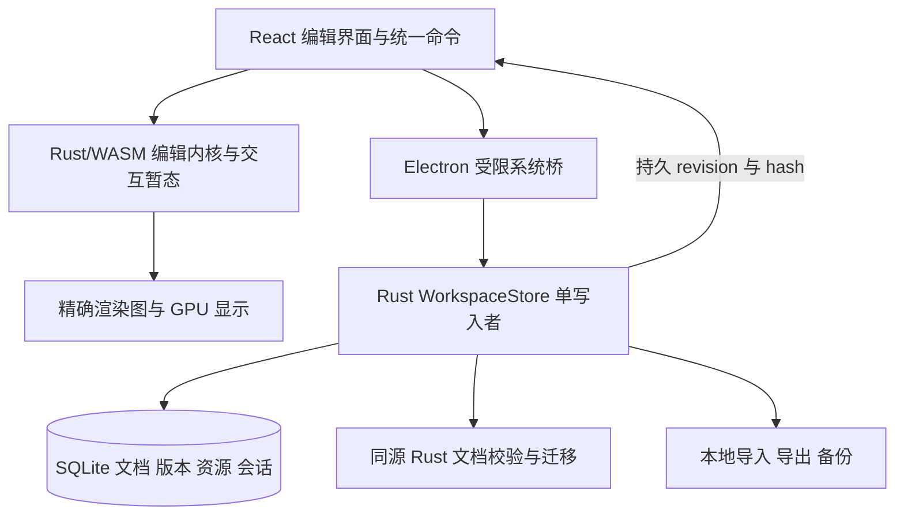

# Forma：macOS 优先的本地设计器与 Figma 对齐方案

更新：2026-10-10。类型：**实施前的源码差距分析与设计快照**。分析基线：`2d87e4d0`。后续用户已授权实现及本地测试，当前实现与测试合同见[本地设计器验收](design-macos-local-validation.md)；以下“当前”均指实施前基线，不代表最新工作树。

## 1. 本轮目标与证据边界

用户要求：以 macOS 为首要平台，对齐 Figma Design 的 UI、操作、画布、算法、编辑功能和导入导出；全部本地运行，后端 Rust，SQLite 作为存储；实时预览必须精确。

本轮只读源码，并读取用户已打开的 Figma macOS 客户端界面。内置浏览器读取超时后改为读取本机 Figma；没有修改 Figma 文档，没有启动或操作 Forma 测试窗口，没有运行测试、构建或性能测量。以下“源码已接通”不表示本轮实测通过。逐项源码身份见[源码映射](../reviews/design-macos-local-parity-source-map-2026-10-10.json)。

对齐目标是可逐项验收的本地设计产品：文档、组件库、变量、原型、版本、注释与资源交付均有本地工作流。Figma 的在线团队目录、多人同步、云 AI 和社区服务需要另外定义本地对应能力，不能用联网依赖填补“全本地”目标。Design、Draw、Motion、Dev 等可见功能入口分别建能力清单，不把其他独立 Figma 产品自动算作已经完成。

**结论：已有较广的编辑能力和精确内核基础；当前存储、桌面行为、最终画布合成和格式兼容仍有结构性缺口。**

## 2. 当前状态与缺口

| 范围 | 当前源码 | 对齐所需工作 |
| --- | --- | --- |
| 本地架构 | Electron + React，Rust/WASM 内核，Rust stdio sidecar；桌面网络受限 | 继续复用同一个 Rust 内核，建立本地文档/资源/版本服务 |
| SQLite | `catalog.rs` 明确为 metadata only，仅项目、目录、文件索引 | 文档正文、持久版本、资源、恢复和会话迁入 Rust 管理的 SQLite |
| 文件与恢复 | `.forma` JSON 原子写入、SHA 冲突检查；另写恢复 JSON；桌面绕过 Web IndexedDB 自动保存 | 统一主存和成功回执；保留 `.forma` 便携交换及旧数据迁移 |
| UI 工作区 | 顶部大量按钮、左图层、中画布、右属性；变量/库/原型集中在模态 | 对齐本机 Figma 的导航、底部工具栏、上下文属性、工作区切换 |
| 画布 | 精确采样恢复，锚点缩放、瓦片、取消、双缓冲 | 修复版本一致提交和分数像素相位；GPU 常驻、局部失效、减少读回 |
| Mac 操作 | 新建/打开/保存/另存/恢复、部分快捷键、全屏 | 统一命令、系统剪贴板、系统字体、Finder 打开、标签/多窗口、Dock 与窗口恢复 |
| 图层/属性 | 树、搜索、虚拟列表、锁/隐藏、拖放、基本多选 | Shift 范围、多项拖放、插入线、内联重命名、键盘树导航、Mixed 属性状态 |
| 矢量创作 | 形状、钢笔、自由绘制、可编辑布尔、描边轮廓 | arc/箭头、完整节点编辑命令、画布渐变和图片裁剪控件、Scale/测距/辅助线 |
| 自动布局 | 横/纵/grid、wrap、hug/fill、约束、min/max、absolute | 基线、负间距、描边参与尺寸、层叠方向、独立 grid track 和画布直接调节 |
| 文字 | Rust shaping/bidi/换行，富文本区间，IME 输入状态，导入字体 | Mac 字体发现与替换、高级 OpenType/轴、斜体、列表/截断等，以及真实 IME 工作流 |
| 组件与变量 | 组件/实例/变体/属性/覆盖，集合/mode/alias/局部继承，本地库 | 资产缩略图、完整变量管理、属性内联绑定、库升级差异和批量操作 |
| 玻璃/纹理 | 独立材质参数、编辑入口和渲染路径存在 | 任意背景/嵌套/旋转/半径/缩放/导出组合仍须分别对照；不能外推有限样本 |
| 原型与动画 | 基本触发/动作/条件，独立关键帧时间轴 | Smart Animate 节点匹配、交互组件 change-to、表达式、滚动/overlay/设备 flow、本地独立预览 |
| 互通 | FIG 有界导入，原生 JSON，PNG，部分 SVG | FIG 字体/覆盖/变量/原型补齐、FIG 导出、JPEG/PDF、明确每种格式的语义和视觉能力 |
| 发布 | 未签名的本机开发包 | arm64 优先：固定 bundle ID、文件关联、安装升级、签名、公证和异常恢复 |

关键入口：[App](../../frontend/design-client/src/App.tsx)、[Canvas](../../frontend/design-client/src/Canvas.tsx)、[Inspector](../../frontend/design-client/src/Inspector.tsx)、[内核 Worker](../../frontend/design-client/src/kernel/render-worker.ts)、[Rust 目录库](../../design-studio/crates/design-desktop-backend/src/catalog.rs)、[桌面主进程](../../frontend/design-desktop/src/main.mjs)。

## 3. UI 与操作的实际对齐目标

### 3.1 本机 Figma 只读观察

本次看到的 Figma 有文档标签栏、左侧 File/Assets/Tools/Variables 导航、可调宽的页面与图层区、底部浮动工具栏、右侧 Design/Prototype 和随选择变化的属性区、顶部右侧预览入口。Forma 目前仍是顶部平铺创作和排版按钮。官方也将文件界面分为工具栏、导航、两侧面板和画布五个区域。[Figma 界面说明](https://help.figma.com/hc/en-us/articles/360039831974-Explore-the-navigation-bar-and-left-sidebar)

[设计] 保留 Forma 品牌，用同类信息层级、控件位置和操作语义组织：

- 文档标签、最近文件、保存状态、文件菜单；状态区区分“编辑中 / 正在保存 / 已保存到本机 / 保存失败”。
- 左导航切换文件、资产、本地库、变量和工具；图层与页面保留独立可调区域。
- 底部工具栏承载选择/平移、frame/section、形状、钢笔、文字和创作模式，工具组选项下沉到对应菜单。
- 右侧按页面、单选、多选、文本、矢量、组件、布局和原型上下文显示。多选不同值显示 Mixed，不能用第一个对象的值冒充共有值。
- 颜色、渐变、描边和材质既可精确输入，也有画布手柄；数值拖拽、键盘步长、单位与变量绑定统一。
- 统一焦点、hover、active、disabled、错误、菜单关闭和 Escape 行为；辅助功能来自编辑语义节点，而非海量瓦片。

### 3.2 命令与 Mac 原生流程

当前 [engine.ts:958](../../frontend/design-client/src/engine.ts#L958) 的复制保存在 Editor 内存；[main.mjs:594](../../frontend/design-desktop/src/main.mjs#L594) 的 Edit 菜单仍是通用原生角色。需要一份命令注册表供菜单、快捷键、按钮、右键菜单和快速操作共用；文本编辑焦点下保留原生文字选择/剪切/撤销语义，画布焦点下执行同一编辑事务。

Mac 首批必须包括：

1. 系统剪贴板：Forma 节点格式、文本、SVG、PNG；剪切、原位粘贴、替换粘贴、跨窗口/跨应用。
2. Finder 双击/拖入文件、`open-file` 待处理队列、最近文档、文件关联；本地库无需每次授权外部目录。
3. 文档标签/多窗口，窗口尺寸/位置与屏幕恢复；⌘W、⌘Q、Dock 激活分别处理。
4. 系统字体枚举、字重/字体面映射、缺失字体替换；落实为实际字体字节/指纹。
5. 触控板 pinch/平移/惯性、中键/空格拖动、鼠标滚轮、修饰键、Retina/多屏；依据真实事件和最终帧测量对齐。
6. 中文 IME、emoji、组合字符、双向文本、光标命中与撤销；不能只看隐藏 textarea 可输入。

当前单窗口和关闭逻辑见 [main.mjs:521](../../frontend/design-desktop/src/main.mjs#L521)、[main.mjs:624](../../frontend/design-desktop/src/main.mjs#L624)。字体入口见 [TextStylePanel.tsx:36](../../frontend/design-client/src/TextStylePanel.tsx#L36)。

## 4. Rust + SQLite 的目标架构

[设计] Rust/WASM 处理快速交互和内存投影；Rust native 后端是持久保存的唯一写入者。两者复用同源文档语义，界面不得直接写 SQLite，也不能有 IndexedDB 与 SQLite 两份独立桌面主数据。基础平台服务继续遵守各自 PostgreSQL 规则，此 SQLite 变更限定设计桌面。

### 4.1 最小数据结构

| 表 | 职责 |
| --- | --- |
| documents | 文档 ID、名称、schema、当前持久 revision、内容 hash、回收站状态 |
| document_revisions | 父 revision、规范快照 BLOB/后续增量、内容 hash、时间 |
| assets | 按 SHA-256 寻址的图片/字体原始 BLOB、类型、大小与色彩元数据 |
| document_assets | 每个文档 revision 引用的资源；历史版本同样保留资源 |
| workspace_sessions | 文档标签、持久 revision、画布视角、面板和窗口状态 |
| export_targets | 外部便携副本路径、上次导出 revision 与文件 hash |
| schema_migrations | 内置迁移版本与校验和 |

首版先保存经过 Rust 验证的完整快照，资源独立去重。避免第一步把全部节点拆为 SQL 行而改变浮点值、顺序和兼容字段；快照/增量压缩与节点索引须有实际热点依据。现有 32 MiB catalog 限额不能直接套到文档主库。

### 4.2 保存与恢复合同

- `document.commit(documentId, expectedRevision, mutationId, snapshot/patch, assetRefs)`；单事务写正文、版本、资源引用和持久游标。
- `mutationId` 去重，`expectedRevision` 检查；回执带 durable revision/hash。未知结果先查询，避免无幂等保障重放。
- “已保存”只对应回执确认的版本；保存时继续编辑产生的新修改仍为未保存。
- 拖动中间帧是暂态，一个完整编辑操作形成事务；自动保存合并待写事务，避免每个 pointermove 写整文档。
- 明确 WAL、同步持久性、busy 时间预算和 checkpoint。对用户确认持久保存的语义，不能把 NORMAL 与 FULL 的掉电差异隐去。[SQLite WAL 文档](https://www.sqlite.org/wal.html)
- 库损坏或空间不足时保留原库和内存文档，显示错误并提供便携紧急导出；不自动清空重建。
- 在线备份通过一致快照/Backup API；运行中的 WAL 数据库不能只复制主 `.sqlite3` 文件。[SQLite 备份说明](https://www.sqlite.org/backup.html)

### 4.3 迁移与便携文件

新 `workspace.sqlite3` 与旧目录库分开建立。只读导入已有 `.forma` 和恢复 JSON，按 hash 去重、逐条记录迁移结果；验证新记录完整前保留原件。桌面当前实际绕过 Web IndexedDB，只在确实发现历史桌面浏览器数据时提供显式迁移。

`.forma` 保持版本化便携快照；从指定持久 revision 导出，并完整携带模型、图片和字体。新容器若要去掉 base64 或加入资源索引，必须升级格式并继续支持旧 JSON。保存到 SQLite 与更新外部副本各有状态；外部副本不成为隐含的第二主存。

## 5. 画布与算法：保持精度的改造顺序

### 5.1 已定位的源码问题

| 问题/风险 | 证据 | 影响与目标 |
| --- | --- | --- |
| 整文档变化使整套瓦片失效 | ProgressiveSurface:174、render-worker:147 | 单节点编辑也大量重绘；建立脏节点/受影响区域与依赖闭包 |
| 每块 GPU 结果回读 CPU | render-worker:555，webgpu:780 | 回读等待、buffer复制、主线程 ImageData；让常规显示保留在同一 GPU device |
| 每块串行编译/绘制 | render-worker:166、521 | 重复工作与长任务；缓存 scene/geometry/参数，按可见性安排有界任务 |
| 新旧文档 revision 逐块共存 | ProgressiveSurface:251、339、373 | **源码风险，未复现**：玻璃背景和前景可能来自不同版本；同一目标视口/文档版本一致提交 |
| CSS 移动/缩放已栅格化瓦片 | ProgressiveSurface:425、tile-cache:1 | **源码风险，未复现**：分数设备像素平移会再次采样；最终显示需要相位合同 |

当前直接请求 `zoom × DPR`、遵守文档 profile 是正确的恢复，但不足以完成最终画布精度与交互验收。旧 106 项只比较相同视口的单块读回，未覆盖多块 DOM 最终合成、分数平移、跨块玻璃背景；旧缓存往返断言 97/99 仍未通过。[历史精确预览记录](../../testing/review/design-desktop-macos-gui-2026-10-10/exact-preview/README.md)

### 5.2 明确采用的方向

1. **版本一致显示**：定义 document revision、camera generation、resource revision；旧任务不能覆盖新任务。文档编辑后的受影响集合完成后原子提交，等待阶段保留上一完整画面并标明计算中。
2. **设备像素相位**：统一世界→CSS→设备坐标。可复用栅格须匹配 scale、DPR、相位、profile、色彩及依赖；非整数设备像素移动要按目标采样重算。最终常规显示尽量由单 GPU surface 在正确像素位置合成，不能以 CSS 重采样证明精确。
3. **局部失效**：Rust 给出变更范围；阴影、玻璃/背景模糊、纹理、蒙版和混合按依赖传播，不能只取当前节点 bounds。图元与参数缓存用内容/资源版本标识，避免全 doc revision 一刀清空。
4. **GPU 常驻**：显示用纹理在同一 device 内合成，读回用于导出/诊断。现有精确色彩编码迁入 GPU pass 时仍需数值对照，不能直接改用驱动默认色彩转换。
5. **有界调度与内存**：优先当前可见集合，取消过期请求，资源按提交完成生命周期释放；分开计主线程、worker、GPU 和历史缓存，不能把一个表面预算当总 RSS。
6. **测量后优化**：拆分输入→命中/编辑→编译→GPU→提交→实际呈现，以及保存延迟；减少搬运、分配和重复编译，保持数值合同。60Hz 的 16.7ms/帧、120Hz 的 8.3ms/帧作为相应设备目标，不写成当前成绩。

Figma 公开披露了 WebGPU、显式绘制参数、批量 uniform 上传和跨 native/WASM 的共享引擎；这些支持架构方向，无法从其界面或文章推出全部私有算法。[Figma 渲染工程说明](https://www.figma.com/blog/figma-rendering-powered-by-webgpu/)

### 5.3 算法约束

保留现有 Rust 几何、扫描区间/覆盖、有理卷积、可认证滤波快路径、文字 shaping/bidi、色彩转换和有明确顺序的合成。相关入口：`rational_filter.rs`、`certified_filter.rs`、`area_program.rs`、`rounded.rs`、`curve_boolean.rs`、`texture_replay.rs`。

- 不减少采样、降低 DPR、替换文档 profile 或改变世界坐标计算顺序以换取速度。
- 不把精确双线性/卷积改成硬件默认 bilinear/普通浮点近似；保持 FMA 边界、预乘、resolve、颜色转换顺序。
- 快路径接受条件必须有误差/位结果证明；不确定时走原精确路径。
- 圆弧、Bezier、Boolean、stroke outline、文字排版分别定义几何与容差合同；已有曲线布尔精度阈值不等于数学绝对精确。
- 玻璃和纹理继续扩展真实对照。现有纹理 replay 有结构范围和已知插值近似，自定义 FIG bevelSize 也有拒绝边界，不能宣称任意材质已经等价。

## 6. 导入导出一致：五项独立合同

| 合同 | 必须比较 |
| --- | --- |
| 原生数据往返 | `.forma → SQLite → .forma` 规范模型、ID、层级、顺序、变量、组件覆盖、文字区间、资源 hash |
| 可编辑迁移 | FIG/SVG 每字段保留情况；缺失、转换、拒绝分别报告；源文件和未识别字段留存不等于可编辑或可无损回写 |
| 内核一致 | 同一快照/profile/字体字节/颜色空间/区域/scale/相位下各后端的 RGBA8 字节和 HDR 原始浮点位 |
| 最终显示一致 | 实际 canvas 合成后的边界、接缝、采样位置和颜色；采用一致背景/输出色彩合同；HDR 显示映射单独核对 |
| Figma 外部一致 | 独立真实 Figma 文件、参数和导出像素；使用未参与调参的留出样本；自身多后端相同不能替代这一项 |

### 当前格式矩阵

| 格式 | 当前范围 | 还需完成 |
| --- | --- | --- |
| `.forma` | 版本化 JSON 开关/验证/保存，资源内嵌 | SQLite 往返、历史/资源事务、版本升级、较大文件流式处理 |
| `.fig` | 有界解码和部分语义导入 | 完整字体/富文本、组件属性与覆盖、变量/原型等；**当前无 FIG 导出器** |
| SVG | 部分可编辑导入/导出；不支持语义显式拒绝；视觉SVG整页嵌PNG | 扩展矢量能力与区域导出；明确位图嵌入不保留矢量可编辑性 |
| PNG | CPU 内核区域/选区/页面和倍率导出，有尺寸/内存上限 | 与最终显示及 Figma 对照，批量资源设置、色彩/透明/DPI完整工作流 |
| JPEG/PDF | 未找到完整导出链路 | 格式编码、页面/文字/矢量语义和明确栅格化边界 |

FIG 的文本字体当前只是告警，实例覆盖重置为基础解析、外部实例缺主组件时变为普通画板，变量/原型只提示检查：[import-fig.ts:591](../../frontend/design-client/src/import-fig.ts#L591)、[import-fig.ts:613](../../frontend/design-client/src/import-fig.ts#L613)、[import-fig.ts:655](../../frontend/design-client/src/import-fig.ts#L655)。完整双向互通需实际编码器与真实 Figma 再打开校验；Figma 官方明确 `.fig` 是会变化的专有格式，局部解码能力不足以承诺任意文件无损。[Figma 本地副本说明](https://help.figma.com/hc/en-us/articles/8403626871063-Save-a-local-copy-of-files)

字体必须按实际文件/字体面/轴/版本识别；只保存 family 名不能保证跨导入导出文字一致。图片保留原字节及 ICC/transfer 元数据。导出从冻结文档 revision 读取，期间继续编辑不得污染正在导出的版本。

## 7. 按依赖推进的实施批次

| 顺序 | 交付范围 | 完成标准（未来验收，不是本轮已通过） |
| --- | --- | --- |
| P0-A | 精确画布 revision/phase、显示一致提交 | 新旧文档不拼帧；指定分数平移/缩放无接缝与额外重采样偏差；不降低采样 |
| P0-B | Rust WorkspaceStore + SQLite 文档/资源/版本 | 创建→编辑→持久确认→重启→恢复；取消/未知结果/崩溃/空间不足都保留可解释结果；旧文件迁移可核对 |
| P1 | Mac 命令、系统剪贴板、字体、Finder、文档会话 | 菜单/快捷键/按钮一致；跨应用复制、实际IME、窗口与文件操作闭环 |
| P2 | Figma 工作区重排、图层、多选、画布直接操控 | 每个交互覆盖空选/单选/多选/锁定/实例/文本焦点及撤销、保存重开 |
| P3 | 布局、文字、组件/变量、玻璃纹理高级语义 | 字段同时接通模型验证、编辑、渲染、保存、导入和导出；不能仅增加按钮 |
| P4 | FIG/SVG/PNG/JPEG/PDF 互通 | 每格式逐字段兼容表、损失报告、原生往返与外部参考；FIG双向单独验收 |
| P5 | Smart Animate、原型、时间轴、本地注释/版本比较/开发交付及工具扩展 | 完整本地设计工作流，明确插件与高级模式的能力清单 |
| P6 | Mac arm64 分发与长时稳定性 | 固定正式应用身份、安装/升级、签名公证、崩溃恢复、多屏/高DPI、长期复杂文档 |

P0-A/P0-B 可以在各自明确所有权下并行；其余按数据模型和命令能力依赖推进。SQLite 保存改造不等待 UI 换肤；UI 不应抢先显示后端尚未具备的“已保存/无损/完整”状态。不要把“接了库”“有个入口”或“smoke ready”作为某功能完成标准。

## 8. 本轮结果

完成当前源码和 Figma 实际界面参照分析，明确以上差距、存储方案、算法约束和交付顺序。**未改运行代码、未测试、未构建、未提交推送。** 历史测试记录保持原始范围，本轮不新增通过数，也不声明完整 Figma 复刻已经完成。
