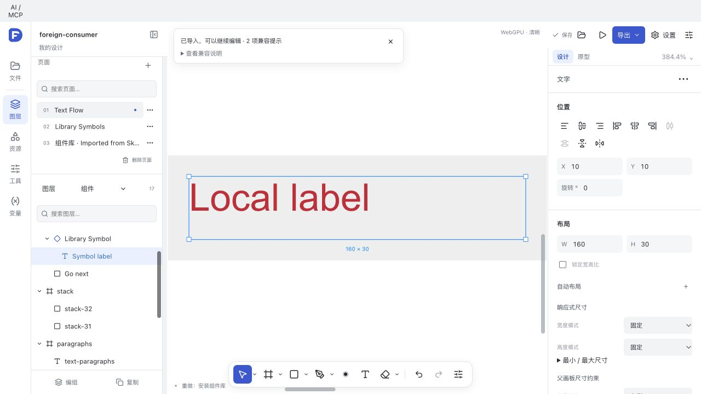
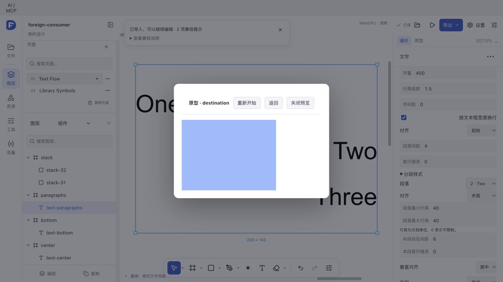
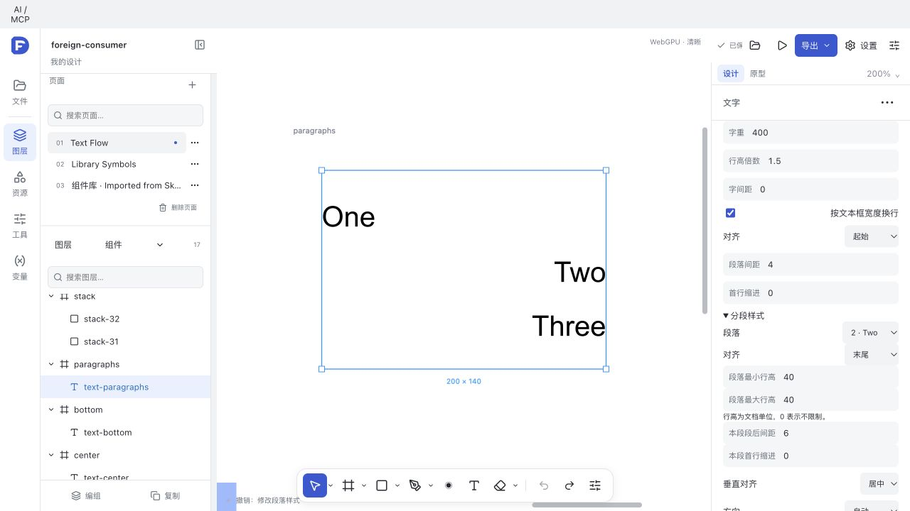

# Sketch 文本、布局、原型与本地库续轮（2026-10-27）

本轮是可执行特性增量，**不是 Sketch 全特性或像素完全兼容验收**。原始 111/117 只读，编辑与导出使用本轮自建副本。

## 实现

- **文本 / schema 20**：段落首字符对应的 run 决定该段对齐、绝对最小/最大行高、段后间距和首行缩进。0 行高界限表示不限制。Inspector 可逐段编辑。垂直对齐共享字形路径、范围颜色、光标和命中坐标，内在尺寸测量不包含对齐偏移；路径缓存补入高度身份。旧全层 lineHeight 倍率和未使用新字段的排版保持原语义。
- **原生字典校准**：Sketch 保存但不执行旧导出键 `textStyleBasicParagraphStyle`；标准 `paragraphStyle` 才使对齐和行高生效。读取保留旧键回退。精确 native projection 相同才恢复自有文本模型 receipt；原生字段编辑后按原生值读取。Attributed color 只在缺少 style fill 时回退，避免重复填充记录；彩色 run 当前会替换 fills，不能据此声称其像素绘制次数减少。
- **现代布局已知子集**：本机 API 证实 Fixed/Fit/Fill/Relative 为 0/1/2/3，pins Min/Max/All 为 1/4/5。现有 Fixed/Hug/Fill 与边缘约束接入可表达值；编辑后回写当前值，保留原字段拼写和未支持值。Relative、复杂 flexItem 和 Inferred Smart Layout 仍未移植。
- **原型**：hotspot 进入现有无绘制矩形命中区域，导出还原 hotspot。前进、返回、滚动保持和四向滑入接入现有播放器；省略 transitionStyle 保持原智能动画。原生 overlay 位置/动画仍未完整映射。
- **本地库**：现有面板接受显式选择的 `.sketch`。源文档身份、摘要和版本决定更新；symbolID + remoteToLocalIDMap 关联嵌入外部 Symbol，保持模板键和实例覆盖。仍为 owned Worker → Editor.change → Rust 解析/布局。外部 master 补入图根，原生导出仅写入 foreignSymbols 一次，本地 ID 随归档转换。没有自动云同步。

## 来源和精度

父目录 `core/sketch-kernel-analysis/06-text.md`、`08-layout.md`、`22-sketch-json-dictionary.md`、`drafts-32/01-text-glyph-pipeline.md` 和 Flow 类转储；本机枚举见 [摘录](native-enum-evidence.txt) 与 [身份](core-sources.json)。也核对了 [Sketch 官方 API](https://developer.sketch.com/reference/api/) 的尺寸、边缘固定和 Flow 语义。

保留浮点/HDR、采样、归档和 GPU 预算，未开启实验开关。原生工具为 Sketch 2025.1.3，使用同一本机 Arial 字体；未反向量化现有几何来迎合原生整数像素位置。

## 原生文件和像素

[Rust 生成器](../../design-studio/crates/design-kernel/examples/sketch_text_flow_fixture.rs)和 [native fixture 脚本](make-native-fixtures.py)构造文本、stack、hotspot、库 v1/v2 与 foreign consumer；去掉图层自有 receipt，真正走原生字段，保留字体资源。

- [最终像素记录](native-portable-pixels-final.json)：7 个画板导入→导出→Sketch 原生重渲染全部 RGBA 差 0。
- 同一记录的 portable/native stack、destination 差 0；文字仍有约 1–2 像素边缘位置/覆盖差，最大通道差可达 255。**跨渲染器文字像素门仍 FAIL**。
- [旧错误键对照](text-native-pixels-initial.json)与 `native-text-key/` 保留。旧 paragraph 文字落在 x=20..72，修正后右对齐达到对应的 x≈219/220。不同输入不能当作严格性能 A/B。
- [GUI 导出](gui-export.sketch)已由 Sketch 导出 7 个画板，含更新后的 foreign Symbol；不代表所有真实文件的原生导出均等价。

## 实际运行链

真实浏览器 WebGPU：导入 foreign-consumer → 第二段居中改末尾、整框垂直居中 → 撤销/重做；原型 Go next 到蓝色 destination → Go back；关联库 v1 → 更新 v2 → 实例保持 `Local label`、颜色变红 → 撤销/重做 → 下载 [FD](gui-saved.fd) 和 Sketch。

最新主目录组合构建和保存重开已完成，见 [verification.json](verification.json) 与 [构建输入核验](main-build-identity-final.json)：2262 项匹配；主目录 31 项 Rust 定向测试、97 项实际 WASM 客户端测试通过，worktree 48 项互通测试通过；默认跳过的真实语料测试单独对 111/117 执行并通过。主目录 FD 重开、段落编辑/历史、父宽 240→340 / Fill 子宽 158→258、800%→200% 和原生滚轮平移已执行；当前标签错误/警告为空。生产前端在 IAB/Chromium WebGPU 验证，未单独启动 Electron，也未逐帧测量滑动动画。早期失败日志保留，包含未加载测试字体、旧“未支持”提示预期、精确 receipt 恢复原始稀疏区间，以及误把图层 fill 色当作范围文字色的断言。没有放宽像素阈值。

## 集成和剩余

[基线](baseline.json)冻结 2611 个 SHA，`baseline-source/` 保留精确旧字节。[集成记录](integration.json)中的 初始 27 个文件全部前置校验后写回主目录；[SVG/类型标注补充](followup-integration.json)和[原型旧帧图完整性补充](prototype-view-integration.json)后合计 30 个独立文件。图片分行加载器只补返回接口类型，保留并发实现。回滚前须确认目标仍匹配 after hash，再恢复旧字节；新增文件仅在 hash 未变时删除，不撤销用户后续编辑。

未完成：彩色字体/emoji 位图与 COLR、tightening、完整 Smart Layout/Relative/flexItem、原生 overlay 对齐/动画、更多混合和滤镜组合像素校准、云端库生态、完整 G2/G4/G5/G7 和物理呈现延迟。本轮局部通过不关闭这些门。

首轮完整构建因并发图片返回类型推断失败，第二轮因构建中修复原型旧帧图范围而触发来源变更守卫；两者均保留为失败日志。第三轮完整构建成功，最终源输入核对为零不匹配。
